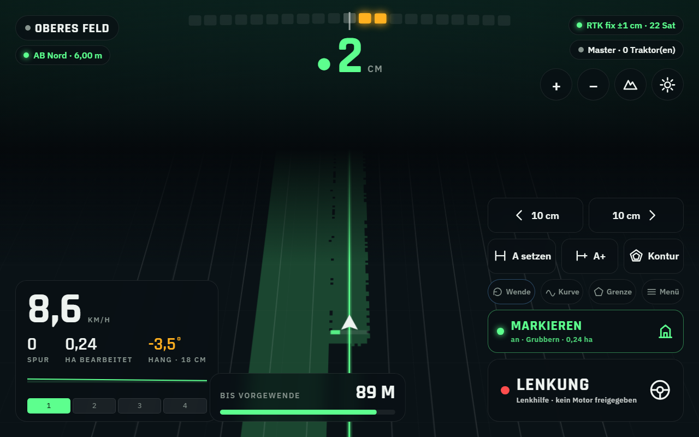
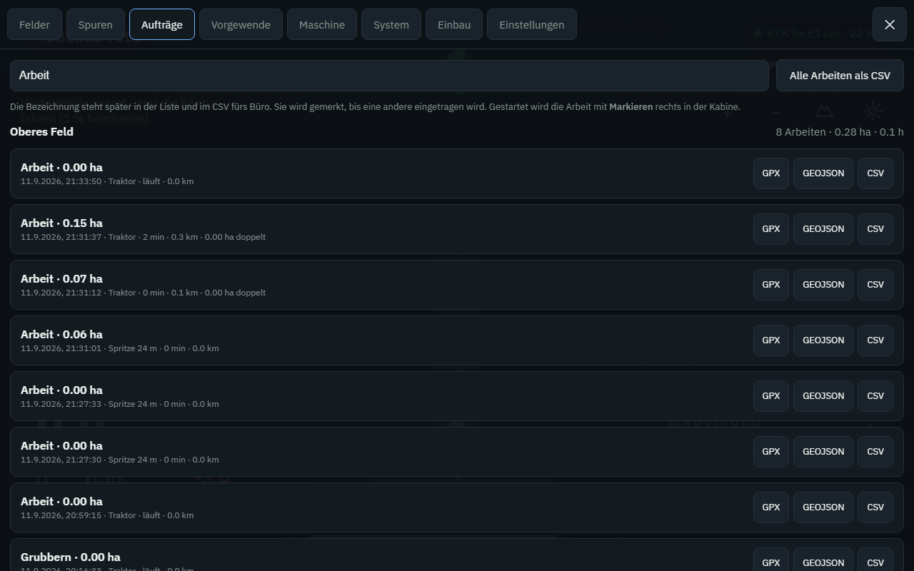

# Bedienung im Feld

## Schnellerer Lenkmotor: Feinabstimmung verlangt Tempo (ab 1.5.78)

Andy, 24.10.2026: „Der Motor muss noch viel schneller reagieren.“ Gebremst haben
ihn die Einstellungen, nicht die Platine: **Größte Leistung 0,55** (nie mehr als
55 %) und **P 0,09** (volle Leistung erst ab 6° Abweichung, darunter kriecht er
mit der Mindestleistung). Die Feinabstimmung hat das abgesegnet, weil ihr 6° in
1,2 s genügten.

Neu in der **Feinabstimmung des Lenkmotors** (Lenkung einrichten, Schritt 5):

* Ziel sind jetzt **6° in 0,5 s** (90 % des Sprungs).
* Läuft der Motor dabei schon an der Größten Leistung, hebt sie die **Größte
  Leistung** in Schritten (×1,3) an, höchstens bis **0,9** – statt nur P zu drehen.
* Schafft der Motor die 0,5 s nicht ohne Überschwingen, gilt der **schnellste
  saubere Durchgang** (Meldung „Schneller geht es mit diesem Motor nicht …“),
  sofern er schneller ist als vorher. Vorher wurde dann alles verworfen.
* Bis zu 12 Durchgänge (etwa eine Minute). Am Stand, Traktormotor läuft,
  Lenkrad nicht festhalten, **Not-Aus in Reichweite**: mit mehr Leistung zieht
  der Motor kräftiger.

**Von Hand:** Menü → Lenkung → Einstellungen **Lenkmotor** → Größte Leistung 0,9,
Eigener Regler P 0,25 (volle Leistung ab rund 3,5°). Überschwingt das Rad, P
etwas senken.

## Träger Lenkmotor: Nachlauf messen, Regelart danach (ab 1.5.77)

Am 24.10.2026 schaukelte sich die Lenkung am John Deere 7530 auf Herrenwiesen
auf: im Mittel 32 cm daneben, bis 1,5 m, zehnmal von selbst abgegeben. Der
Lenk-Assistent hatte nur die Lenkschärfe gesenkt (0,9 → 0,61). Ursache ist ein
**träger Lenkmotor**: Das Rad folgt dem Befehl erst nach einer guten Sekunde. Dann
schaukelt sich die Regelart **Stanley** auf, egal wie sanft sie eingestellt ist,
und der **Ausgleich Dauerversatz** schaukelt kräftig mit.

Im Simulator mit so einem Motor (0,6 s Totzeit, 1 s Trägheit, 6 °/s) und Andys Werten:
Stanley 15–34 cm im Mittel, bis 71 cm und wachsend. **„Vorausschauend“ mit der
Trägheit = gemessenem Nachlauf: rund 2 cm.**

Neu:

* **AgriPilot misst den Nachlauf selbst**, solange die Lenkung lenkt: aus dem
  Befehl und dem Radwinkel vom Drehgeber. Steht unter *Lenkung live* und beim
  Lenk-Assistenten („Rad folgt dem Befehl 1,6 s später“).
* **Der Lenk-Assistent stellt um:** Pendelt die Maschine und folgt das Rad 0,6 s
  oder später, stellt er (bei „Stellt selbst nach“) die Regelart auf
  **Vorausschauend** und die **Trägheit der Lenkung** auf den gemessenen
  Nachlauf. Ist schon „Vorausschauend“ eingestellt, hält er die Trägheit beim
  Messwert (zwischen dem 0,6- und 1,4-Fachen bleibt sie stehen). Bei „Nur
  Vorschläge“ sagt er es nur. „Auf die Ausgangswerte zurück“ stellt auch die
  Regelart zurück.
* **Der Ausgleich Dauerversatz pausiert, solange die Maschine pendelt**, und baut
  sich langsam ab (*Lenkung live*: „Ausgleich Dauerversatz pausiert“).
* **Lenkung einrichten:** Mindestleistung, Zählwerte und Feinabstimmung sind
  offen, sobald Lenkmotor verbunden und Drehrichtung geprüft sind – in beliebiger
  Reihenfolge. Die Freigabe wartet weiter auf alle Schritte.
* **Simulator:** Totzeit, Trägheit und Lenkgeschwindigkeit des Rads lassen sich
  einstellen (`POST /api/simulator` mit `lenk_totzeit_s`, `lenk_traegheit_s`,
  `lenk_rate_deg_s`).

**Von Hand, ohne Assistent:** Traktor & Gerät → Lenkung → Regelart
„Vorausschauend“, Trägheit der Lenkung = der Wert aus *Lenkung live* (sonst 1,0 s
zum Anfangen), „Traktor übernehmen“.

Nicht am Traktor geprüft. Langsamer Motor bleibt ein Hardware-Thema: Größte
Leistung und Feinabstimmung des Lenkmotors machen ihn schneller.

## Genauere Flächenmarkierung ab 1.5.43

Grün zeigt die bearbeitete Fläche, Bernstein kennzeichnet die Überlappung mit
bereits bearbeiteten Rasterzellen. Die kleine Legende erscheint bei laufender
Arbeit oder vorhandener bearbeiteter Fläche. Der aktive Markieren-Schalter hat
zusätzlich einen grün getönten Hintergrund.

Für die Darstellung wird die Fahrt jetzt auch längs in Abschnitte bis0,5m
unterteilt. So wird beim Einfahren in eine schon bearbeitete Fläche nur der
betroffene Abschnitt bernsteinfarben. Das Live-Endstück und die gespeicherte
Zeichnung werden gemeinsam mit gleichmäßiger Deckkraft angezeigt. Eingelesene
Rasterzellen erscheinen als zusammenhängende Reihen ohne zusätzliche Fugen.
Die farbige Vorschau bleibt eine Darstellung; die Hektar- und
Überlappungsberechnung des Servers verwendet weiterhin ihr ursprüngliches Raster.

Neu eingeschaltete Teilbreiten malen die davor gefahrene Strecke nicht nach.
Wird im Stand eingeschaltet, beginnt die Markierung bereits beim Losfahren.
Auftragswechsel verbinden keine getrennten Arbeiten durch einen Streifen.
Gerätebreite und tatsächlich bestätigte Teilbreiten bleiben maßgebend.

## Überarbeitete Tablet-Oberfläche ab 1.5.42

Fahransicht und Menü haben ruhigere Flächen, klarere Schriftgrößen und
kontrastreichere Eingaben. Feld/Spur, Lichtbalken und GPS-Zustand sind getrennt
angeordnet; auf schmalen Geräten stapeln sich die Statusanzeigen. Die
Bedienleiste bleibt rechts im Querformat und unten im Hochformat. Der vorhandene
Schalter **Tag oder Nacht** wechselt weiterhin beide Ansichten.

Das Menü zeigt AgriPilot und die aktuelle Seite im Kopf. Zusammengehörige
Formulare, Listen und Kalibrierungsschritte sind mit einheitlichen Abständen
gegliedert. Ungespeicherte Eingaben behalten ihre blaue Markierung. Aktive
Wenden behalten die deutlich blaue Stopptaste. Tastaturfokus bleibt sichtbar;
bei reduzierter Bewegung entfällt die neue kurze Menü-Einblendung.
Die Lenk-, Geräte- und Synchronisationsfunktionen sind unverändert. Keine
Arbeitsbreiten werden durch diese Gestaltung angepasst. Die Gestaltung und
lokalen Schriften funktionieren weiterhin ohne Internet.

## Lenkwerkstatt ab 1.5.41

Unter **Menü → Lenkung** steht oben die Lenkwerkstatt für den gewählten Traktor.
Die Einrichtung erfolgt auf dem jeweiligen Traktor-Tablet. Der Büro-Master
verbindet und verteilt weiterhin Felder und Aussaat-Fahrgassen; Fahrzeugmaße,
Motorabstimmung und laufende Lenkberechnung bleiben lokal.

1. Arbeit beenden, Lenkung ausschalten und anhalten. Aktuelle GPS-Daten sind
   nötig, damit Stillstand geprüft werden kann. Der echte Büro-Master bietet
   keine schreibende Traktorkalibrierung; Simulator und Wiedergabe sind Übungen.
2. Radstand, Antennenhöhe und Antennenversatz ab der Mitte der Hinterachse
   messen. Nach hinten bzw. links sind die Werte negativ. Die beiden
   maximalen Lenkwinkel beziehen sich auf die Räder am Boden.
3. Alle sechs Maße eintragen, die Messung bestätigen und **Maße übernehmen**.
   Vorherige Traktorwerte werden automatisch gesichert. **Traktorwerte sichern**
   legt ausdrücklich einen neuen Sicherungsstand an; **Sicherung wiederherstellen**
   holt ihn zurück und sichert dabei umgekehrt die eben ersetzten Werte.
4. Darunter den vorhandenen Motorablauf ausführen: Verbindung, Drehrichtung,
   Mindestleistung, Zählwerte, Feinabstimmung, Einbau/Not-Aus und Probefahrt.
   Diese Prüfungen gehören zum gewählten Traktor und zu den zugehörigen
   Einstellungen. Änderungen können frühere Bestätigungen ungültig machen.
5. **Prüfstand dokumentieren** und bei Bedarf den Prüfbericht herunterladen.
   Offene Schritte und spätere Änderungen bleiben erkennbar. Ein Übungsprotokoll
   bestätigt keinen echten Einbau.

Die Sicherung umfasst Traktorgeometrie und Spurregler. Sie setzt weder die
Motorregler-Konfiguration noch die Gerätebreiten zurück. Öffnen, Vermessen und
Speichern der Werkstatt bewegen keinen Motor. Bei Traktorwechsel oder anderen
Einstellungsänderungen bleibt ein ungespeicherter Entwurf erhalten und wird
gegen falsche Zuordnung gesperrt; **Aktuellen Traktor neu laden** verwirft ihn.

## Kalman-Positionsfilter ab 1.5.41

Unter **Einstellungen → Empfänger** lässt sich der **Kalman-Positionsfilter** zuschalten.
Ab Werk ist er aus. Er schätzt Position und Geschwindigkeit in lokalen Metern
und gewichtet die Messungen nach ihrer Genauigkeit. Das Beschleunigungsrauschen
ist einstellbar; der Standard beträgt 2 m/s². Dies ersetzt keine Kalibrierung.

Der ursprüngliche GPS-Fix und seine Freigabekriterien bleiben maßgebend. Der
Filter erzeugt kein RTK-fix aus einer schlechteren Messung und überbrückt keinen
GPS-Ausfall. Bei Zeitlücke oder Qualitätswechsel wird neu angesetzt. Verworfene
Positionssprünge werden gemeldet; die Lenkung wird ausgeschaltet und der
Teilbreitenwunsch sofort auf AUS gesetzt. Erst nach Prüfung wieder freigeben.
Ein wiederholter Sprung kann zu einem neuen Filteransatz führen; eine gültige
GPS-Meldung beweist keine tatsächlich korrekte Position.

## Teilbreiten-Hardware ab 1.5.41

Unter **Traktor & Gerät → Teilbreiten-Hardware** (unten auf der Seite) stehen Ausgang, Adapteradresse und Port.
Solange keine Hardware gewählt ist, bleibt **Aus – nur Software** eingestellt;
die bisherige Software-Markierung bleibt damit erhalten.

Für spätere Hardware gibt es einen UDP-Relais-Adapter nach dem eigenen Protokoll
`agripilot-teilbreiten/1`. Das ist keine Hersteller- oder ISOBUS-Zusage. Ein
passender Adapter muss die tatsächlich geschalteten Ausgänge zurückmelden und
bei ausbleibenden Befehlen selbst innerhalb von 500 ms abschalten. Bis zu
32 Teilbreiten sind unterstützt. Einrichtung nur ohne laufende Arbeit, ohne
Lenkfreigabe und im Stand.

Bei aktiviertem UDP-Ausgang zählen Anzeige und Flächenmarkierung nur frisch
bestätigte Teilbreiten. Ohne Rückmeldung erscheint kein erfundener Schaltzustand.
Bei Arbeitsende, ungültigem GPS, Positionsausreißer oder veralteten Fahrdaten
wird AUS angefordert. Die Abschaltung echter Ventile muss zusätzlich der Adapter
gewährleisten. Details und Beispieltelegramme stehen in **TEILBREITEN.md**.
Noch keine reale Teilbreitenhardware wurde ausgewählt oder geprüft.

## Dubins-Wende ab 1.5.41

Unter **Vorgewende & Wende** kann zusätzlich zu Omega und U **Dubins** ausgewählt
werden. Die Planung prüft sechs vorwärts fahrbare Verbindungen aus Kreisstücken
und Geraden, mit dem gewählten Radius und der Zielrichtung auf der nächsten
Spur. Für Gegenlenkbögen gilt die strengere der beiden Lenkwinkelgrenzen.

Die kürzeste abgetastet im Feld liegende Variante wird bevorzugt, wenn die
Feldgrenzenprüfung eingeschaltet ist. Passt keine, bleibt die entsprechende
Startfreigabe gesperrt. Vorschau ansehen und die Wende weiterhin bewusst starten.
Ab 1.5.45 wird zusätzlich die berechnete Gespannhülle geprüft (siehe unten).
Hindernisse und die Fahrbarkeit des Bodens werden dadurch nicht erkannt.
Dubins-Bögen haben ideale Krümmungswechsel; Lenkdynamik und tatsächliche
Wendefläche sind vor realem Einsatz zu erproben. Keine automatische Hindernisumfahrung.

## Gemeinsame Aussaat-Fahrgassen ab 1.5.40

Der Master im Büro verbindet die Arbeiter-Tablets. Beim Säen auf **Tablet A**
den Saatplan mit **Als Aussaat übernehmen** festlegen oder die gefahrene Spur
mit **Als Aussaat festlegen** kennzeichnen und das **Erntejahr** auswählen.
Damit sind Spur, Versatz, Fahrgassenabstand und die im Saatplan festgelegten
Fahrgassenpositionen dem Feld zugeordnet. Ein begonnener Arbeitsauftrag allein
veröffentlicht noch keine neue Aussaat.

Nach erfolgreichem Abgleich **Tablet A → Büro-Master → Tablet B** lädt Tablet B
beim Öffnen dieses Feldes dieselbe Aussaat. Beim Wechsel auf Streuer oder
Spritze bleiben die Fahrgassen an denselben Stellen in Metern. Die jeweilige
Gerätebreite bestimmt weiterhin die lokale Darstellung und Spurführung. Ein
Jahreswechsel löscht die Fahrgassen nicht; **erst eine neu festgelegte Aussaat**
ersetzt den maßgebenden Stand. Das Erntejahr ist eine ausdrückliche Zuordnung,
kein automatisches Ablaufdatum. Saatplanstände anderer Erntejahre bleiben gespeichert.

Kommt eine neue Aussaat an, während das Feld schon geladen ist, wird sie ohne
laufende Arbeit, ohne Aufzeichnung/Wende und ohne Lenkfreigabe übernommen.
Während Arbeit oder Lenkfreigabe bleibt die bisherige Spur aktiv. Die Anzeige
meldet neue Fahrgassen; nach der Arbeit das Feld neu laden oder erneut abgleichen,
sobald die Lenkung ausgeschaltet ist. Es gibt keinen automatischen Spurwechsel
während einer laufenden Arbeit oder freigegebener Lenkung.

Alle Geräte benötigen diesen Programmstand und denselben erreichbaren Master.
Bei fehlender Verbindung bleiben die zuletzt übertragenen Daten lokal verfügbar.
Eine neue Aussaat von A erreicht B erst nach dem nächsten erfolgreichen Abgleich
beider Tablets mit dem Master. Auch verspätet eingehende Offline-Daten werden
vom Master weitergereicht. Der Master berechnet dabei keine laufenden Lenkbefehle;
diese und die Lenkabstimmung bleiben auf dem jeweiligen Traktor-Tablet.

## Traktor-Tablet und Büro-Master ab 1.5.39

Das Tablet im Traktor berechnet die Lenkbefehle aus seinen eigenen GPS- und
Sensordaten. Der Lenk-Assistent läuft dort und muss dort auf „Stellt selbst
nach“ stehen, wenn er automatisch abstimmen soll. Ein eingeschalteter Assistent
am Büro-Master gilt ausschließlich für den Büro-PC.

Vorhandene Fahrzeug- und Lenkwerte eines Arbeiter-Tablets bleiben beim
Netzabgleich und beim Einspielen eines Datenpakets erhalten. Dazu gehören
Antenne, Radstand, Lenkanschläge, Regelart, Lenkschärfe und Vorhalt. Namen und
neue Traktoreinträge können weiter aus dem Büro kommen; neue Einträge bringen
Ausgangswerte mit und müssen am echten Traktor eingerichtet werden. Der gerade
gewählte Traktor wird durch eine Löschung aus dem Büro nicht automatisch gewechselt.
Änderungen und ein ausdrücklicher Wechsel am Tablet bleiben möglich.

Automatisch nachgestellte Tablet-Werte werden als neue Traktorfassung zum
Master übertragen. Der Büro-Master sammelt weiterhin Felder, Spuren, Geräte
und Arbeiten und verteilt Programmupdates. Er sendet keine laufenden Lenkbefehle.
Bei unterbrochener Verbindung arbeitet die lokale Lenkung weiter, soweit die
örtlichen GPS-, Freigabe- und Hardwarebedingungen erfüllt sind. Die Freigabe
der Automatik bleibt beim Fahrer. Die Zuständigkeit setzt voraus, dass das
Traktor-Tablet als **Arbeiter** eingerichtet ist und mit seinem lokalen
AgriPilot-Dienst verbunden ist, nicht mit der Browseransicht des Büro-Masters.

## Flüssigere Anzeige ab 1.5.38

Die Karte verwendet unveränderte parallele Kurven- und Konturspuren wieder,
statt sie in jedem Bild neu auszurechnen. Ein Spurwechsel oder ein geänderter
Versatz erscheint weiter sofort. Das entlastet die Anzeige auf dem Tablet.
„Lenkung live“ wertet seine Messwerte nur bei sichtbarer Anzeige aus; die
Aufzeichnung läuft im Hintergrund weiter. Beim Öffnen stehen die inzwischen
gesammelten Messwerte zur Verfügung. Im Hochformat sitzt das kleine Livefenster unter den Statusanzeigen, damit es nicht von den unteren Tasten verdeckt wird.

## Der Bildschirm

**Ab 1.5.65** stehen auf den zwei großen Knöpfen unten rechts Symbole statt Wörter, wie
bei Cerea: oben das **Gerät mit gemalter Fläche = Markieren**, unten das **Lenkrad =
Lenkung**. Der Punkt in der Ecke und die Zeile darunter sagen den Zustand (aus, an ·
0,12 ha, scharf · zu langsam, aktiv). Die runden Knöpfe an der Karte (Zoom, Ansicht,
Luftbild, Sprache, Tag/Nacht) haben einen kräftigeren Rand; eingeschaltet sind sie blau
gefüllt – auch in der hellen Tagansicht gut zu erkennen.



Die Anzeige ist der Blick über die Haube: das Feld liegt in Perspektive vor dem
Traktor, die Spur läuft zum Horizont. Alles Wichtige liegt als Glasfläche
darüber.

```
 ┌──────────────────────────────────────────────────────────────┐
 │ Oberes Feld     ▓▓▓▓▓░░░░░░░│░░░░░░░░░░       RTK fix ±1 cm │
 │ Kontur · 6,00 m        ◀ 12 cm                 Master       │
 │                                                       + − ⛰ ☼│
 │                    ╲    │    ╱                               │
 │                     ╲   │   ╱             ◀ 10 cm   10 cm ▶  │
 │   8,6  km/h          ╲  │  ╱             A setzen  A+  Kontur│
 │   5    0,09  −3,5°    ╲ │ ╱              Wende   Kurve   Menü│
 │   Ring ha    Hang      ▲                ● MARKIEREN  an      │
 │   [1][2][3][4]   bis Vorgewende 38 m   ● LENKUNG    aktiv    │
 └──────────────────────────────────────────────────────────────┘
```

**Der Lichtbalken oben ist die eine Anzeige, die man im Augenwinkel lesen kann.**
Er leuchtet auf der Seite, auf der die Spur liegt – **zum Licht hin lenken**, bis
nur noch die Mitte brennt. Eine Lampe sind 5 cm. Grün heißt unter 5 cm, gelb bis
20 cm, rot darüber. Die Zahl darunter sagt es genau; der Pfeil daneben zeigt in
dieselbe Richtung: wohin zu lenken ist.

**Links unten** die Fahrt: Geschwindigkeit, Spur- oder Ringnummer, bearbeitete
Hektar, Hang mit Ausgleich. Die kleine Kurve darunter ist der Verlauf der
Abweichung der letzten Sekunden – man sieht, ob die Führung ruhig arbeitet oder
pendelt. Bei mehreren Teilbreiten steht der Sektionsbalken darunter.

**Unten Mitte** die Strecke bis zum Vorgewende – bis zum *Beginn* des
Vorgewendes, nicht bis zur Grenze. Sie erscheint nur, wenn eine Feldgrenze
gespeichert und eine Vorgewendetiefe eingestellt ist. Unter 20 m wird sie
bernsteinfarben und ruft es über der Karte aus. Während einer Wende zeigt
dieselbe Fläche den Fortschritt der Wende.

**Rechts** die Handlungsspalte, nach Wichtigkeit von unten nach oben – unten
liegt die Hand am montierten Tablet ohnehin:

| | |
|---|---|
| **Lenkung** | der größte Knopf. Grün und leuchtend: die Automatik lenkt. Bernstein: scharf, aber gerade nicht am Lenken – der Grund steht darunter (zu langsam, kein RTK, zu weit von der Spur). Grau mit rotem Punkt: aus. Tippen schaltet um. |
| **Markieren** | darüber. An = die bearbeitete Fläche wird gemalt, Hektar und Überlappung laufen mit, die Fahrt wird aufgezeichnet. Aus = nur Führung. Die Bezeichnung der Arbeit (Grubbern, Säen…) steht unter Menü → Aufträge. |
| **A setzen / B setzen · A+ · Kontur** | eine Spur anlegen – siehe unten. Kontur ist zugleich die Grenze: einmal um das Feld fahren, fertig. |
| **◀ 10 cm · 10 cm ▶** | das ganze Spurmuster um zehn Zentimeter versetzen. |
| **Wende · Kurve · Menü** | klein, weil selten gebraucht. |

**Oben rechts** unter den Statuschips: Näher, Weiter, Ansicht, Tag/Nacht. Die
Ansicht wechselt zwischen **Perspektive** (Blick über die Haube), **Flach**
(Fahrtrichtung oben, wie eine Karte) und **Norden oben**. **Tag** schaltet auf
hellen Grund – ein schwarzer Bildschirm hat in praller Sonne die wenigsten
Reserven. Beides wird auf dem Tablet gemerkt.

Zwei Finger auf der Karte zoomen. Die Perspektive ist keine 3D-Grafik: die
Karte wird flach gezeichnet und vom Browser gekippt, das kostet das Tablet fast
nichts.

**Der Hang-Wert** erscheint nur, wenn ein Neigungssensor eingerichtet ist. Er
zeigt die Schräglage, und der Ausgleich dazu läuft im Hintergrund: bei 3 m
Antennenhöhe sind 6° Hang 31 cm, um die die Spur sonst wandern würde. Der Wert
färbt sich, sobald der Ausgleich mehr als 15 cm ausmacht – dann arbeitet er
gerade spürbar.

## Schlag auf der Karte auswählen (Menü → Felder → Karte, ab 1.5.64)

Wie bei Cerea: über der Feldliste schaltet **Liste | Karte** um. Die Karte zeigt alle
Schläge mit Umriss und Namen, das geladene Feld grün, den Traktor als blauen Pfeil.
Darunter liegen die Luftbilder, die schon geholt sind (sonst oben „Luftbilder aller
Felder laden“ – danach geht es auch ohne Netz). Mit einem Finger verschieben, mit zwei
Fingern oder dem Mausrad zoomen, doppelt tippen zoomt hinein. **Einen Schlag antippen**
wählt ihn: er wird gelb, darunter stehen Name, Hektar und wie weit der Traktor weg ist,
daneben **Laden**. Weit herausgezoomt sind kleine Schläge Punkte mit Namen – auch die
lassen sich antippen. **Alle Felder** zeigt wieder alles, **Traktor** springt zum
Traktor. Welche Ansicht zuletzt offen war, merkt sich das Tablet.

## Ein Feld anlegen und vermessen

1. Auf das Feld fahren, **Menü → Felder**, Namen eingeben, *Feld hier anlegen*.
   Der Bezugspunkt wird an der aktuellen Position gesetzt und ändert sich nie
   wieder – daran hängt, dass zwei Traktoren dieselbe Fläche gleich sehen.
2. **⬠ Kontur** drücken und einmal um das Feld fahren (die Taste zeigt
   währenddessen „Kontur fertig“).
3. Am Ausgangspunkt wieder **⬠ Kontur** drücken. Die Fläche in Hektar steht
   sofort da und ist gespeichert – und die Kontur ist aktiv: Ring 0 ist die eben
   gefahrene Grenze, jeder weitere Ring liegt eine Arbeitsbreite weiter innen.
   Grenze und Kontur sind dieselbe Linie, deshalb ein Knopf.

Soll die Grenze später neu abgefahren werden: **Menü → Felder → Grenze neu
abfahren**, dann um das Feld fahren und mit **Kontur** abschließen.

Die Grenze ist nicht nur Buchhaltung: die Sektionen schalten außerhalb der
Grenze automatisch ab.

### Felder aus dem Flächenantrag (Shapefile)

Wer die Flächen schon als Shapefile hat – aus dem Flächenantrag, aus dem
Kataster, aus einem anderen Lenksystem –, muss sie nicht abfahren:
**Menü → Felder → Shapefile einlesen** und die drei Dateien `.shp`, `.dbf`
und `.prj` zusammen auswählen (auf dem Tablet aus dem Dateimanager, vom
USB-Stick oder aus dem Download-Ordner). Je Fläche entsteht ein Feld; der Name
kommt aus der Tabelle (`SCHLAGNAME`, `NAME`, `FLIK` …), die Hektarzahl aus
der Grenze, der Bezugspunkt liegt mitten im Feld.

Verstanden werden ETRS89/UTM (Zone 32N und 33N, mit oder ohne die Zone im
Ostwert) und WGS84-Grad – das ist, was die Antragsportale und QGIS ausgeben.
Gauß-Krüger auf dem alten DHDN-Datum wird abgelehnt, mit Begründung: die
Umrechnung dahinter ist ohne Tabellen nur auf Meter genau, und eine Grenze,
die still zwei Meter daneben liegt, ist schlimmer als keine. Dann in QGIS oder
im Portal als EPSG:25832 exportieren.

Kommt dieselbe Datei später noch einmal – der Antrag hat sich geändert –,
bekommt ein Feld gleichen Namens die neue Grenze, seine Spuren und Arbeiten
bleiben. Löcher in einer Fläche (ein Teich) werden weggelassen; eine Fläche
aus mehreren Teilen wird zu mehreren Feldern „Name (1)", „Name (2)".

## Eine Spur anlegen

**Gerade Spuren (AB-Linie)** – der Normalfall:

1. Am Feldrand in Arbeitsrichtung ausrichten, **A setzen** drücken.
2. Bis zum anderen Ende fahren – derselbe Knopf heißt jetzt **B setzen**, drücken.

Fertig. Alle weiteren Spuren liegen im Abstand der Arbeitsbreite parallel dazu.

**A+ – wenn kein Platz für einen B-Punkt ist:** die Taste **A+** rechts. Die
Spur läuft dann genau in die
Richtung, in die der Traktor gerade zeigt. Gut, um die Richtung vom Nachbarfeld
oder vom letzten Jahr zu übernehmen.

**Kurven** – für krumme Felder: **∿ Kurve** drücken, die gewünschte Linie
abfahren, wieder **∿ Kurve** drücken. Alle weiteren Spuren folgen dieser Form.

**Kontur – die Feldgrenze selbst als Spur:** die Taste **Kontur** rechts.
Gibt es noch keine Grenze, zeichnet der Druck sie auf (siehe oben); gibt es
sie, wird sie zur Spur. Ring 0 ist die Feldgrenze, jeder weitere Ring liegt
eine Arbeitsbreite weiter innen. Kein A- und kein B-Punkt nötig, und nichts
abzufahren, was ohnehin schon abgefahren wurde – die Grenze ist da. Gedacht für das Vorgewende und für krumme
Schläge. Wie herum die Grenze aufgezeichnet wurde, spielt keine Rolle: Ring 1
liegt immer weiter innen, nie weiter außen.

**Ecken.** Eine abgefahrene Grenze hat den Wendekreis des Traktors, eine aus
dem Flächenantrag hat rechte Winkel. Um eine rechtwinklige Ecke kommt die
Lenkautomatik nicht: sie hält die Spur bis zur Ecke, dahinter wäre sie mehr
als die erlaubte Abweichung daneben und setzt aus. Deshalb steht 40 m vorher
oben links „Ecke in 38 m – von Hand um die Ecke, danach greift die Lenkung
wieder“: um die Ecke lenkt der Fahrer, auf der nächsten Kante zieht die
Automatik von selbst wieder auf den Ring, sie bleibt scharf.

Die Kontur wird **nicht gespeichert**: sie entsteht bei jedem Aufruf neu aus der
aktuellen Grenze. Wer die Grenze neu abfährt, hat sofort die neue Kontur. Eine
gespeicherte Kopie läge nach dem nächsten Abfahren still daneben – und man
sähe es erst abends an den Streifen im Feld.

Angelegte Spuren stehen unter **Menü → Spuren** und lassen sich jederzeit wieder
laden. Die Kontur steht nicht in dieser Liste; sie wird über den Knopf geholt.

Jede Spur gehört zu ihrem Feld. Unter **Menü → Felder → Spuren ▾** stehen sie
beim Feld, mit *Laden*, *Umbenennen* und *Löschen* – und mit dem Knopf, der
eine Spur zur Saisonspur macht.

### Saisonspur und Fahrgassen

Beim Säen entscheidet sich, wo das ganze Jahr gefahren wird: die Fahrgassen.
Düngen und Spritzen sollen später genau diese Spuren treffen, sonst liegt die
Spritze neben der Fahrgasse und fährt durch den Bestand. Deshalb wird die
Spur vom Säen als **Saisonspur** gespeichert: **Menü → Felder → Spuren ▾ →
Als Aussaat festlegen**. Das Erntejahr auswählen, z. B. 2027 für die
Herbstaussaat 2026. **Aussaat erneuern** legt die nächste Aussaat ausdrücklich
fest; **Fahrgassen aufheben** entfernt die Zuordnung nach Bestätigung. Der Abstand
der Fahrgassen ist die **Fahrgassenweite**, oben auf der Seite *Spuren*
(Taste „Fahrgassenweite: 21 m", Vorgabe 21 m = Spritze und Streuer).
Eine geänderte Fahrgassenweite gilt nur für neu gesetzte Saisonspuren – schon
angelegte Fahrgassen bleiben, wo sie sind. Von da an

* wird diese Spur beim Laden des Feldes **automatisch aktiv** – bis zur nächsten festgelegten Aussaat,
  bei jeder Arbeit, ohne dass jemand daran denken muss;
* liegen die Fahrgassen **fest in Metern**: alle 21 m ab Spur 0, bei jeder
  Arbeitsbreite an derselben Stelle. Auf dem Bildschirm sind sie **rot
  gestrichelt**; Fahrgasse ist die Spur, in deren Streifen sie fällt (bei 3 m
  jede siebte). Geht die Breite nicht glatt auf (4 m), wandern sie trotzdem
  nicht. Die aktive Spur leuchtet rot statt grün, wenn sie eine Fahrgasse ist;
* steht im Spur-Chip oben links „Fahrgassen 21 m".

Wird mit Spritze oder Streuer gearbeitet (21 m), ist jede Spur eine Fahrgasse –
die Führung läuft auf denselben Linien.

**Randspur als Saisonspur** („Rand …"): Die Randspur selbst liegt auf der
Feldgrenze. Als Saisonspur beginnt das Raster deshalb an der Grenze statt auf
ihr: die erste Spur jedes Geräts fährt mit der Gerätekante auf der Grenze
(Spurmitte eine halbe Arbeitsbreite drinnen, Drille 3 m: 1,5 m), die erste
Fahrgasse liegt eine halbe Fahrgassenweite drinnen (10,5 m), dann alle 21 m.
So fährt die Drille die Fahrgasse in ihrer vierten Spur, und Spritze und
Streuer fahren mit 21 m schon in der ersten Spur darauf. Welche Seite innen
ist, weiß AgriPilot aus der Feldgrenze. Ohne Saisonspur bleibt Spur 0 auf der
Grenze wie bisher.

Der Kalenderwechsel beendet die Fahrgassen nicht. Maßgebend ist die zuletzt
festgelegte Aussaat, auch über den Jahreswechsel hinweg. Bloßes Umbenennen
einer alten Spur macht sie nicht zur neuen Aussaat. Alte Saisonspuren bleiben mit Erntejahr in der Liste stehen.

### Saatplan: den Schlag vor der Aussaat durchplanen (Menü → Saatplan)

Der Saatplan rechnet den ganzen Schlag mit Säspuren und Fahrgassen durch, bevor
die Drille aufs Feld fährt.

**Auf dem Acker:** an die Ecke fahren, an der es losgeht, in Richtung der ersten
Spur ausrichten, **Spur → Saatplan** drücken (oder im Menü **Ab hier planen**).
AgriPilot nimmt die nächste Ecke (höchstens 40 m weg) und die Kante, die dort in
Fahrtrichtung zeigt. Am Schreibtisch geht es auch mit einer gewählten Ecke: **die
längste gerade Kante steht in der Auswahl oben und ist vorgewählt** (ab 1.5.64, „längste
Kante“) – an ihr fängt man beim Säen an. **Fast gerade Bögen zählen mit** (ab 1.5.66):
weicht eine „Kurve“ höchstens 1,5 m oder 1 % ihrer Länge von der Geraden zwischen ihren
Enden ab, steht sie als „(fast gerade)“ in der Auswahl; gesät wird parallel zu dieser
Geraden. So ist auf Höllochweg die 406-m-Südostkante (2,9 m Stich) wählbar und vorgewählt.
**Ab 1.5.69 ist jede Kante ab 20 m wählbar:** „fast gerade“ gilt bis 3 m oder 2 % Stich; stärker
gebogene stehen am Ende der Auswahl als „(Bogen, Stich x m)“ – vorgewählt wird nie ein Bogen.
Die Vorschau hat eigene Farben (nicht die Kartenfarben): Grenze dunkel, Startkante kräftig
blau mit Pfeilen und „A“ an der Startecke, „B“ an der Gegenseite, Vorgewende als getöntes Band.
**Kante im Bild wählen (ab 1.5.70):** eine Feldkante im Vorschaubild antippen macht sie zur
Startkante – gestartet wird an dem Ende, das näher am Finger liegt; dieselbe Kante nochmal
antippen dreht die Richtung um (oder der Knopf **Richtung**). Der Plan wird gleich gerechnet.
Mit der Maus leuchtet die Kante unter dem Zeiger auf. **↺ ↻** drehen das Bild um 90°, **Auto**
legt die Startkante wieder waagrecht. Nach dem Antippen bleibt das Bild stehen, damit das
zweite Antippen dieselbe Kante trifft.
Weitere Eingaben: **Sämaschine** (z. B. 3 m), **Fahrgassenweite** (21 m) und
**Säspuren am Rand vor der Fahrgasse** (3) – sie bleiben beim Feld gespeichert.

**So wird gesät:** von der Startecke (A) so viele Fahrgassen wie passen, alle
21 m, und nach der letzten Fahrgasse noch eine Säbreite. Dann an der
Gegenseite (B) anfangen: 3 Säspuren ab der Grenze, die Fahrgasse auf 10,5 m,
und weiter Richtung A bis zur letzten Säspur von A. So fällt eine Überlappung
immer auf diese eine Säbreite von A, nie in eine Fahrgasse. Damit das geht,
liegen die letzte Fahrgasse von A und die von B mindestens zwei Säbreiten (6 m)
auseinander, höchstens 21 m plus zwei Säbreiten. Der Plan nennt den Abstand,
die Teilbreite für Spritze und Streuer an der Fahrgasse von B (bei weniger als
21 m) bzw. wie weit an beiden weiter gestreut werden muss (bei mehr), die Zahl
der Säspuren von B her und die Überlappung der letzten. Die Reihenfolge steht
beim Plan; was von B her gesät wird, ist auf der Karte bernsteinfarben.

**Gestufte oder spitz zulaufende Schläge (ab 1.5.56):** Die Gegenseite B ist nur eine
gerade Kante, hinter der der Schlag wirklich aufhört. Eine Stufe mitten in der Grenze
zählt nicht als B. Gibt es hinten keine solche Kante, laufen die Säspuren von A mit
ihren Fahrgassen bis zum Ende durch. Jede Säspur wird an der echten Grenze geschnitten
und hält überall die Vorgewende-Tiefe ein, so bekommen auch Ecken und Dreiecke hinter
einer Stufe ihre Säspuren. Vorher blieb dort ein Teil des Schlags leer (am 23.10.2026 auf
Fünfzehn Jauchert fast ein Hektar). **Ältere Pläne neu rechnen:** einmal **Ab hier
planen** bzw. die Startecke neu wählen.

* **Vorgewende** rundum, so tief wie eine Fahrgassenweite: bei 3 m und 21 m
  sieben Runden – drei Säspuren, die Fahrgasse auf 10,5 m, drei Säspuren.
* **Hauptfeld** parallel zur Startkante im Raster der Drille, Fahrgasse alle
  21 m, ausgerichtet an der Randvorgabe (die erste wieder bei 3 Säspuren +
  Fahrgasse vom Vorgewende aus).
* Auf der Karte: Säspuren dünn, **Fahrgassen rot** mit Nummer (FG 1, FG 2 …)
  und Abstand, Vorgewende gestrichelt. „Plan auf der Karte“ blendet ihn aus.

**Prüfung:** Die Randvorgabe geht nur auf, wenn die Fahrgassenweite eine
ungerade Zahl Säbreiten ist ((2 · 3 + 1) · 3 m = 21 m) – sonst ein Konflikt mit
Vorschlag. Läuft ein Rand schräg zur Fahrtrichtung (Keil), passen 21 m dort
nicht durchgehend: Konflikt, Vorschlag Teilbreitenschaltung oder an diesem Rand
beginnen. Ein zu schmaler Schlag (unter 2 × 21 m) hat kein Hauptfeld.

**Als Aussaat übernehmen** legt drei Spuren an. Geladen wird **„Saatplan … · alle
Spuren“ (ab 1.5.61)**: darin steckt jede geplante Spur einzeln – das Hauptfeld von A,
die Spuren von der Gegenseite B und alle Vorgewende-Runden rundum. Alle sind auf der
Karte zu sehen (Fahrgassen rot gestrichelt, die aktive leuchtet), und auf jeder lenkt
die Automatik, ohne dass man umschaltet: Sie nimmt die nächste Spur, die zur
Fahrtrichtung passt. Quer liegende Spuren zählen nicht – wer am Ende einer Spur ins
Vorgewende fährt, bleibt auf seiner Spur, bis er auf die Runde einschwenkt. Die
aktuelle Spur bleibt, bis man eine dreiviertel Arbeitsbreite daneben ist. Unten links
steht, welche es ist: „A 12“, „B 3“ oder „Runde 4“. Ein Gerät so breit wie die
Fahrgassenweite (Spritze, Streuer mit 21 m) fährt auf dieser Spur nur die Fahrgassen –
auch die Vorgewende-Fahrgasse und die von B. Schmalere Geräte (Walze, Striegel)
nehmen jede passende Spur.

**Vorgewende-Runden an Einbuchtungen (ab 1.5.63):** Die Runden sind die Grenze, um
1,5 m, 4,5 m, 7,5 m … nach innen versetzt. An einspringenden Ecken (Einbuchtung,
Stufe, Mast-Ecke) und an spitzen Zipfeln schnitt sich der Versatz früher selbst, und
es blieben Zacken quer durchs Feld. Jetzt hat jede Runde überall genau ihren Abstand
zur Grenze; zerfällt der Schlag an einem engen Hals, bekommt jeder Teil seine eigene
Runde. **Ein vorher übernommener Plan hat noch die alten Runden: einmal
„Als Aussaat übernehmen“ drücken** – dabei wird der Plan mit der gespeicherten
Vorgabe neu gerechnet.

Daneben bleiben die zwei AB-Spuren: „Saatplan … A“ durch die
erste Fahrgasse (10,5 m von der Startkante) und „Saatplan … B“ durch die Fahrgasse von B. Die
B-Spur beim Säen von B her laden: dort liegt das Raster um den Rest versetzt. Sie kennt genau
die geplanten Fahrgassen – die von A und die von B, sonst keine – und
nimmt sie beim Abgleich mit aufs Tablet. Sie gilt das ganze Jahr: beim Säen zeigt das Band „Fahrgasse“, wann die
Fahrgassenschaltung dran ist; Spritze und Streuer (21 m) fahren dieselben
Gassen. Ein neuer Plan und nochmal übernehmen ersetzt die alte Saatplan-Spur.

## Arbeiten



**Markieren** drücken. Die Bezeichnung (Grubbern, Säen, Spritzen) steht unter
**Menü → Aufträge** und bleibt, bis eine andere eingetragen wird. Ab jetzt:

* wird die bearbeitete Fläche grün mitgezeichnet,
* laufen Hektar, Strecke und Überlappung mit,
* wird die Fahrspur für den Nachweis aufgezeichnet.

Am Ende wieder **Markieren** drücken. Der Auftrag steht unter **Menü → Aufträge** mit
Datum, Dauer, Strecke, Fläche und doppelt bearbeiteter Fläche – als GPX,
GeoJSON oder CSV herunterladbar. *Alle Arbeiten als CSV* gibt die Liste für das
Büro.

**Arbeiten löschen (ab 1.5.59):** hinten in jeder Zeile **Löschen** für eine
einzelne Arbeit, am Ende einer aufgeklappten Feldgruppe *Alle … Arbeiten von „Feld“
löschen*, und ganz unten **Alle Arbeiten löschen**. Jedes Mal kommt vorher eine
Rückfrage. Die bearbeitete Fläche verschwindet mit aus der Karte, und das Löschen geht
beim nächsten Abgleich an den Master und alle Tablets – die Arbeit kommt nicht zurück.
Eine Arbeit, die gerade läuft, wird nie gelöscht; erst **Markieren** beenden.

## Spurversatz (Nudge)

**Rechts heißt rechts vom Sitz aus** – auch auf einer Spur, die gerade
rückwärts (von B nach A) gefahren wird, und auf der Kontur, egal ob im oder
gegen den Uhrzeigersinn. Nach **10 cm ▶** leuchtet der Balken rechts, der Pfeil
zeigt nach rechts, und die Lenkung zieht nach rechts auf die versetzte Spur.


Die Tasten **◀ 10 cm** und **10 cm ▶** verschieben das **ganze Spurmuster** um
zehn Zentimeter – das ist der Schritt, den man im Feld braucht. Dafür gibt es zwei gute Gründe:

* Zwei Traktoren stehen minimal verschieden auf derselben Spur.
* Nach einer Pause hat sich die RTK-Lösung um ein paar Zentimeter verschoben.

Wichtig: der Versatz verschiebt alle Spuren gleichzeitig, nicht nur die
aktuelle – sonst wäre das Muster nach einer Runde krumm. Er wird beim Feld
gespeichert.

## Sektionen (Teilbreiten schalten wie in AgOpenGPS, ab 1.5.57)

Bei mehreren Teilbreiten steht unten links ein Balken: vorn der **Hauptschalter**, dahinter
je Teilbreite ein Knopf.

* **Hauptschalter** (tippen schaltet weiter): **AUTO** – die Automatik schaltet nach
  Überdeckung, Feldgrenze, Tempo und auf Wunsch Vorgewende. **MAN** – alle an (gelb).
  **AUS** – alle zu, es wird nichts markiert.
* **Je Teilbreite** (tippen schaltet weiter): Auto → **fest an** → **fest aus** → Auto.
* **Farben:** grün = offen, grau = von der Automatik geschlossen, gelb = fest an,
  rot = fest aus. Auf der Karte hat das Gerät dieselben Farben.
* **Vorlauf:** Ventile und Säschare brauchen Zeit. Die Automatik prüft deshalb zwei Linien
  vor dem Gerät, die mit dem Tempo wachsen und auf der Karte gestrichelt zu sehen sind.
  **Grün (Einschalten)**, Vorgabe 1,0 s Fahrt voraus: Liegt dort noch freier Boden, bleibt
  die Teilbreite offen bzw. geht auf. **Rot (Ausschalten)**, Vorgabe 0,5 s: Erst wenn hier
  und an der grünen Linie alles bearbeitet ist, schließt sie. Ein Teilstück schaltet also
  nicht hin und her, wenn man aus bearbeitetem Boden herausfährt.
* **Die Karte markiert, wo das Mittel landet** (ab 1.5.58): ein Teilstück gilt erst die
  Einschaltzeit nach dem Befehl als an und die Ausschaltzeit danach als aus – so, wie das
  Ventil reagiert. Der Vorlauf ist genau Tempo × Sekunden (kein fester Zuschlag mehr). Passen
  die beiden Zeiten zu den Ventilen, bleibt an einer bearbeiteten Bahn weder Lücke noch
  Überlappung (geprüft bei 4–16 km/h quer über eine Bahn). Sieht man am Acker an jeder Kante
  eine Lücke oder Überlappung, die Zeiten anpassen: Lücke beim Hineinfahren in Bearbeitetes →
  Vorlauf Ausschalten kleiner; Überlappung beim Herausfahren → Vorlauf Einschalten kleiner.
  Schräg über eine Bahn bleibt eine Teilbreite offen, bis „Abschalten ab“ (Anteil) überdeckt
  ist – kleinere Teilbreiten oder ein kleinerer Anteil sparen dort Mittel.
* **Feldgrenze und Vorgewende** zählen an der roten Linie: was hinausragt, schließt sofort.
  **Im Vorgewende abschalten** (Gerät) misst den echten Abstand zur Feldgrenze – sinnvoll,
  wenn das Vorgewende am Ende extra gefahren wird.
* **Aus unter** (Vorgabe 1 km/h) und **rückwärts** schließt die Automatik alles; was fest
  an ist, bleibt an.

Einstellen unter **Traktor & Gerät → Gerät → Arbeitsbreite und Teilbreiten**: Vorlauf
Einschalten, Vorlauf Ausschalten, Aus unter, im Vorgewende abschalten. Übernommen ist das
Bedienkonzept von AgOpenGPS, nicht dessen Code. Nicht an echter Teilbreiten-Hardware geprüft.

Automatisch geschlossen wird eine Sektion, wenn sie über bereits bearbeitetes
Land oder über die Feldgrenze hinaus laufen würde. Geprüft wird ein Stück
voraus – je schneller gefahren wird, desto weiter, damit ein Ventil rechtzeitig
schließt.

Antippen schaltet eine Sektion von Hand ab und wieder frei. Die Automatik
insgesamt lässt sich unter **Menü → Maschine** abschalten.

## Vorgewende und Wenden (Menü → Vorgewende)

Das Vorgewende ist kein zweites Feld, sondern eine Tiefe: so viele
Arbeitsbreiten vom Rand nach innen, wie zum Wenden gebraucht werden. Es kommt
deshalb aus der Feldgrenze und wandert mit dem Gerät mit – wer ein breiteres
Gerät anhängt, hat automatisch ein tieferes Vorgewende.

**Einstellen:** Anzahl der Vorgewendespuren (üblich 2), Alarmabstand,
kleinster Wendekreis der Maschine, Wendemuster und Wenderichtung. Eine Breite
je Spur trägt nur ein, wer ein Vorgewende will, das breiter ist als die
Maschine; sonst bleibt dort die Null stehen.

**Im Feld sichtbar** wird daraus dreierlei:

* Die **gestrichelte Linie** innerhalb der Feldgrenze – dort endet die Arbeit.
* Die Anzeige **„m bis Vorgewende"** oben. Sie zählt bis zum *Beginn* des
  Vorgewendes, nicht bis zur Grenze. Wer bis zur Grenze zählt, wendet zu spät.
  Die Zahl wird negativ, sobald man drin steht – das sagt auch, wie weit.
* Der **Annäherungsalarm**: unter dem eingestellten Abstand blinkt der Hinweis
  rot und der Vorgewendering wird rot.

**Arbeitsreihenfolge – Vorgewende zuerst oder zuletzt.** Das Programm erzwingt
keine Reihenfolge; es kann nicht wissen, warum heute anders herum gefahren wird.
Aber es sieht hin: ob das Vorgewende schon bearbeitet ist, liest es aus der
markierten Fläche (abgetastet entlang der Mitte des Vorgewendes, alle drei
Meter). Steht „zuerst" und eine AB-Spur ist aktiv, während das Vorgewende noch
leer ist, sagt es das oben links – mit dem Prozentsatz, der schon bearbeitet
ist. Auf der Kontur zeigt es, welcher Vorgewende-Ring gerade dran ist. Was nicht
mit **Markieren** gefahren wurde, zählt dabei nicht – das Programm sieht nur,
was es gemalt hat.

### Wenden

Die kleine Taste **Wende** rechts hat drei Zustände, und sie sagt jedes Mal,
was sie als Nächstes tut:

1. **„Wende"** – planen. Die Route erscheint gestrichelt auf der Karte, blau
   wenn sie im Feld liegt, rot wenn nicht.
2. **„Ω los"** – die Maschine folgt der Route.
3. **„Ω Stopp"** – zurück an den Fahrer.

Zwei Druck, nicht einer: eine Wende, die auf Knopfdruck losfährt, hat niemand
vorher angesehen.

**Die beiden Muster:**

| | |
|---|---|
| **Ω-Wende** (weiter Bogen) | Fährt erst ein Stück von der Zielspur weg und kommt dann in einem großen Bogen zurück. Ideal, wenn der Versatz kleiner ist als zwei Wendekreise (Nachbarspur). Braucht Vorgewendetiefe von etwa 2,5 Wendekreisen. Ab zwei Wendekreisen Versatz ist sie eine U-Wende. Der Übergang zwischen den Bögen ist eine Klothoide: die Lenkung bekommt Strecke zum Umschlagen. |
| **U-Wende** (kompakt) | Zwei Viertelkreise mit einer Geraden dazwischen. Kommt mit deutlich weniger Tiefe aus; dafür wächst die Zwischengerade mit dem Spurversatz. |

**Fahrbar oder nicht:** Radstand und größter Einschlag geben den kleinsten Kreis, den die Maschine fahren kann (2,6 m und 35 Grad: 3,7 m). Liegt der engste Bogen der geplanten Route darunter, steht dort **„Wende zu eng für die Maschine“**, und die Wende lässt sich nicht starten – auch nicht mit abgeschalteter Feldprüfung. Abhilfe: Wendekreis größer stellen (Menü → Vorgewende; für diese Maschine rund 4,2 m) oder mehr Spuren überspringen.

**Was die Wende nicht tut:** rückwärts fahren. Gesteuert wird das Lenkrad, nicht
Fahrstufe und nicht Gas – ein Muster mit Rückwärtsgang wäre eine Route, die die
Maschine nicht fahren kann. Wo der Platz für keines der beiden Muster reicht,
wird von Hand gewendet.

**Die Sicherheitsprüfung** verlangt, dass *jeder* Punkt der Route innerhalb der
Feldgrenze liegt. Ein einziger draußen genügt zur Ablehnung – der Rest im Feld
hilft nichts, wenn das Vorderrad im Graben steht. Ohne gespeicherte Feldgrenze
kann nicht geprüft werden; dann sagt die Anzeige das auch.

Während der Wende zeigt die Abweichung oben den Abstand **zur Wenderoute**,
nicht zur verlassenen Spur. Das ist kein Schönheitsfehler, sondern nötig: die
Lenkautomatik gibt ab, wenn die Abweichung zu groß wird, und in einer Wende ist
man von der alten Spur zwangsläufig weit weg. Wer der Route nicht folgt, bekommt
sie abgebrochen und lenkt selbst weiter.

Bei einem Positionsausfall endet die Wende sofort. Blind auf einem Bogen zu
lenken ist schlimmer als gar nicht zu lenken.

## Lenkautomatik

Nur verfügbar, wenn sie bei der Installation freigegeben wurde.

**Lenkung** drücken schaltet scharf. Sie lenkt erst, wenn alles stimmt:

| Bedingung | Anzeige, wenn sie fehlt |
|---|---|
| in der Konfiguration freigegeben | „in der Konfiguration deaktiviert" |
| vom Fahrer scharf geschaltet | „nicht scharf" |
| Spur geladen | „keine Spur aktiv" |
| RTK-Fix vorhanden | „RTK nötig, aktuell: …" |
| schnell genug | „zu langsam" |
| nicht zu schnell | „zu schnell" |
| näher als 1,5 m an der Spur | „zu weit von der Spur (… m)" |
| Positionsdaten frisch | „GPS-Daten veraltet (… s)" |

Sitzt ein Drehgeber am Lenkmotor, lernt das System beim Scharfschalten die
Geradeausstellung – **beim Scharfschalten müssen die Räder also gerade stehen.**
Neu setzen lässt sie sich über **Menü → Lenkung → Lenkung: Mitte lernen**, etwa
nachdem von Hand nachgelenkt wurde.

**Ins Lenkrad greifen schaltet sofort ab** und die Lenkung bleibt aus, bis sie
neu scharf geschaltet wird. Am Vorgewende wird von Hand gewendet – eine
automatische Wende gibt es bewusst nicht.

## Mit zwei Traktoren auf einem Feld

Beide laden dasselbe Feld (**Menü → Felder → Laden**). Jeder zeichnet seine
eigene Fläche auf; sobald Verbindung zum Master besteht, sieht jeder auch, was
der andere schon bearbeitet hat – und die Sektionen schalten entsprechend ab.

Ohne Verbindung arbeitet jeder Traktor vollständig weiter. Der Abgleich holt
alles nach, sobald der Master wieder erreichbar ist.

## Lenkmotor mit Phidget21 (MotorControl 1065)

Ist auf dem Tablet der ältere **Phidget21**-Treiber installiert (so läuft die
MotorControl 1065 auch mit dem AgriPilot Terminal), spricht AgriPilot die
Platine direkt über USB an – kein COM-Port, kein Phidget22 nötig.
**Menü → Daten & Geräte → Geräte suchen** findet sie über Phidget21 („… (Phidget21) –
1 Motor, 1 Drehgeber, 2 Analogeingänge“), **Gefundene Geräte übernehmen** stellt
Phidget-Treiber „Phidget21“, die Seriennummer, den eigenen Regelkreis und den
Drehgeber als Rückmeldung ein. Einstellbar unter **Menü → Lenkung → Lenkmotor (Phidget) →
Phidget-Treiber** (automatisch / Phidget22 / Phidget21).

Unter Phidget21 kann die 1065 weniger als neuere Platinen:

* **kein Failsafe** – die Platine hält den Motor nicht selbst an, wenn das
  Programm verstummt. Beim Beenden setzt AgriPilot die Geschwindigkeit auf null;
  gegen einen harten Absturz hilft nur der **Not-Aus. Der ist Pflicht.**
* **keine einstellbare Stromgrenze**,
* **kein Positionsregler** – AgriPilot regelt selbst (50-mal je Sekunde).

**Motor testen:** **Menü → Lenkung → Motor links/rechts** (erscheint, sobald der
Lenkmotor bereit ist). ◀ / ▶ dreht den Motor 0,5 s mit 10–35 % Leistung und zeigt,
wie weit sich der Drehgeber bewegt hat. Das geht nur mit ausgeschalteter Lenkung
und braucht die Freigabe der Lenkautomatik nicht – dafür muss unter
Menü → Lenkung → Lenkautomatik der **Ausgang „Phidget“** stehen (Geräte suchen →
übernehmen, danach AgriPilot neu starten). Fahrzeug steht, Not-Aus griffbereit.

Wichtig: **das AgriPilot Terminal vorher schließen.** Solange es die Platine
offen hat, findet AgriPilot sie nicht. Die Zählwerte des Drehgebers je Grad
Radeinschlag (**Drehgeber: Zählwerte je Grad**) einmal ausmessen, nicht schätzen.

## Lenkung einrichten (Menü → Lenkung)

Auf der Seite Lenkung, in der **Lenkwerkstatt**, führt **„Lenkung einrichten“** in acht Schritten von der
Verbindung bis zur Probefahrt. Jeder Schritt hat seinen Knopf und bekommt einen
Haken, wenn er erledigt ist. Mindestleistung, Zählwerte und Feinabstimmung sind
offen, sobald Verbindung und Drehrichtung stimmen; Freigabe und Probefahrt warten
auf alle früheren Schritte (der Not-Aus-Schritt steht immer frei). Am Stand arbeiten: Lenkung aus, Räder
in der Mitte, Not-Aus griffbereit.

1. **Lenkmotor verbinden** – sucht die Phidget-Steuerung (Phidget21 oder 22) und
   stellt den Lenkausgang darauf ein, ohne Neustart. AgriPilot Terminal vorher zu.
2. **Drehrichtung prüfen** – der Motor lenkt kurz „nach rechts“; du sagst, wohin
   die Räder gingen (rechts / links / gar nicht). AgriPilot stellt daraus
   **Motor-Drehrichtung** und **Drehgeber umkehren** selbst richtig und will zur
   Kontrolle einen zweiten Test. Das ist der wichtigste Schritt: stimmt die
   Richtung von Motor und Drehgeber nicht überein, lenkt die Regelung vom Ziel
   weg statt hin.
3. **Mindestleistung einmessen** – wie „Motor einmessen“ unten (Losbrechleistung).
4. **Zählwerte je Grad messen** – Anschläge von Hand anfahren; den
   Gesamteinschlag der Räder am Boden darüber eintragen.
5. **Feinabstimmung des Lenkmotors** – am Stand, Traktormotor läuft (Servolenkung),
   Räder in der Mitte: der Motorregler fährt mehrmals 6° nach rechts und zurück und
   bewertet jeden Sprung (Zeit bis 90 % – Ziel 0,5 s –, Überschwingen, Schwingen,
   Rest). Danach stellt er P, I und D nach – überschwingt er: weniger P, mehr D; zu
   langsam: mehr P, und läuft der Motor schon voll, mehr **Größte Leistung** (bis
   0,9); bleibt er vor dem Ziel stehen: etwas I. Höchstens zwölf Durchgänge, feste
   Grenzen. Wird es nicht ganz sauber, gilt der schnellste saubere Durchgang; gibt
   es keinen, bleiben die alten Werte und der Grund steht da.
6. **Not-Aus und Einbau** – unten in der Einbau-Liste „Lenkmotor anbauen“ abhaken.
7. **Lenkung freigeben** – erst jetzt darf die Automatik lenken.
8. **Probefahrt** – die Feinabstimmung der Spurregelung: „Nur Vorschläge“ oder
   „Stellt selbst nach“ schaltet den Lenk-Assistenten ein; auf einer AB-Spur
   5–8 km/h geradeaus, Lenkung scharf. Erledigt, sobald er „gut“ meldet.

„Von vorn beginnen“ löscht die Haken (nicht die Einstellungen).

## Lenkung live (Menü → Lenkung)

Oben auf der Seite Lenkung zeigt **Lenkung live**, was die Lenkung gerade tut:

* **Oben:** die Abweichung von der Spur in cm (+ = rechts), grün hinterlegt ±2,5 cm.
* **Unten:** der verlangte Einschlag (blau), was das Rad wirklich tut (orange, vom
  Drehgeber) und die Motorleistung (grau).
* **Grau hinterlegt:** Lenkung aus. **Grüne Striche:** hier hat der Lenk-Assistent
  Lenkschärfe oder Latenz verstellt.

Darunter ein **Befund** über die letzten 30 s Fahrt mit Lenkung, mit dem, was man
dreht:

| Befund | Bedeutung | Abhilfe |
|---|---|---|
| Gut | Abweichung klein | nichts |
| Pendelt | schwingt mit Periode und Weite um die Spur | Lenkschärfe senken (bei „Vorausschauend“ Trägheit erhöhen) |
| Bleibt daneben | Dauerabweichung zu einer Seite | Antenne seitlich nachmessen, Spur verschieben |
| Träge | kommt nur langsam zurück | Lenkschärfe erhöhen |
| Rad folgt später | Rad hinkt dem Befehl hinterher | ab 0,6 s: „Vorausschauend“ mit Trägheit = Nachlauf; darunter Latenz bzw. Trägheit auf diesen Wert |
| Volle Motorleistung | Motor kommt nicht hinterher | Motorregler / Mindestleistung (Lenkung einrichten) |

**Auf der Karte einblenden** legt dieselben Kurven klein neben die Zahlen unten
links – so sieht man während der Fahrt, was eine Änderung bewirkt. Mit ✕ wieder weg.

Im **Simulator** folgt das Rad jetzt wie am Traktor träge (0,3 s) und mit höchstens
30 °/s – so lässt sich das Abstimmen am Schreibtisch ausprobieren.

## Lenk-Assistent (Menü → Lenkung)

Der Assistent merkt, wie die Lenkung die Spur hält, und stellt die Spurregelung in
kleinen Schritten nach. Er wertet die Querabweichung aus, solange die Lenkung
lenkt und das Fahrzeug **ruhig geradeaus** fährt (3–21 km/h, keine Wende, kein
Spurwechsel, kein Versatz in den letzten Sekunden), in Fenstern von 20 Sekunden:

* **pendelt** (gleichbleibendes Hin und Her um die Spur, oder es schaukelt sich
  auf): die **Verstärkung** sinkt um 15 %. Hilft das an der Untergrenze nicht,
  wird der **Vorhalt** für die Lenkverzögerung um 40 ms größer (höchstens 300 ms).
  Verlässt die Maschine die Spur, nachdem sie sie gehalten hat, gilt das auch als
  Pendeln - ohne auf ein Fenster zu warten.
* **zu träge** (große Abweichung ohne Pendeln): die Verstärkung steigt um 15 %,
  als **Versuch**. Nach einem Fenster zum Einschwingen wird verglichen: bringt es
  nichts, geht der Schritt zurück, und der Assistent sagt, dass es keine Frage der
  Reglerstärke ist (Lenkmitte, Hang oder Versatz prüfen).
* **gut:** nichts ändern.
* **träger Motor** (ab 1.5.77): Folgt das Rad gemessen 0,6 s oder später und es
  pendelt, kommt das vor allem anderen: Regelart „Vorausschauend“, Trägheit =
  Nachlauf (siehe oben).

Modus: **Aus**, **Nur Vorschläge** (zeigt, was er ändern würde) oder **Stellt selbst
nach**. Es gibt höchstens einen Schritt je Fenster und zwölf je Einschalten; die
Verstärkung bleibt zwischen 0,3 und 2,0. **„Auf die Ausgangswerte zurück“**
stellt die Werte vom Einschalten wieder her. An der Hardware (Strom, Failsafe,
Anschläge) ändert der Assistent nichts.

**Motor einmessen** (am Stand, Lenkung aus, Räder in der Mitte, Not-Aus griffbereit,
nur beim Phidget-Lenkmotor): Der Motor dreht abwechselnd rechts und links in
kleinen Impulsen und stufenweise stärker (8 % bis 35 %). Die erste Stufe, bei der
der Drehgeber mitzählt, ist die **Losbrechleistung**; daraus wird die
**Mindestleistung** vorgeschlagen. **Anschläge messen:** starten, von Hand von
Anschlag zu Anschlag lenken, beenden – mit dem Gesamteinschlag der Räder (Vorgabe
70°) ergeben sich die **Zählwerte je Grad**. **Ergebnis übernehmen** schreibt sie in
die Einstellungen. Der Wert „Gesamteinschlag“ bestimmt das Ergebnis: möglichst
den echten Einschlag der Räder am Boden eintragen.

## Neigungssensor nullen

Einmal beim Einbau und danach, wenn der Sensor bewegt wurde: auf **ebenem**
Boden **Menü → Lenkung → Neigungssensor nullen**. Der Sensor sitzt nie exakt
waagerecht in der Kabine, und ein Grad Montagefehler sind bei 3 m Antennenhöhe
schon 5 cm Dauerversatz in jeder Spur.

Prüfen lässt sich der Ausgleich am besten so: über eine Furche fahren, sodass
der Traktor kippelt. Die angezeigte Abweichung darf dabei fast ruhig bleiben.
Wird sie beim Kippeln größer, arbeitet der Ausgleich verkehrt herum – dann
gehört in die Konfiguration `roll_sign: -1.0`.

## Mehrere Maschinen (Menü → Maschine)

Der Schlepper mit dem Grubber ist eine andere Maschine als derselbe Schlepper
mit der Spritze: andere Arbeitsbreite, anderes Gerät hinter der Achse, gezogen
oder angebaut. Deshalb gibt es oben im Reiter eine **Auswahl aller Maschinen**.
*Neue Maschine* legt eine weitere an – mit den aktuellen Werten als Vorlage,
unter neuem Namen; danach nur ändern, was anders ist. Die Auswahl gilt sofort:
Spurabstand, Sektionen und Werkzeugpunkt springen um, die Spur bleibt. Die
gewählte Maschine steht auch im Chip oben rechts und in jeder aufgezeichneten
Arbeit. Die letzte Maschine lässt sich nicht löschen – eine muss es geben.

**Gerät hinter Achse, gezogen oder angebaut.** Diese Maße bestimmen, wo
markiert wird – die grüne Fläche entsteht am Gerät, beim gezogenen Gerät mit
seinem Nachlauf in der Kurve. **Gelenkt wird immer auf die Hinterachse**, nie auf
das Gerät: ein Punkt fünf Meter hinter der Achse schwenkt beim Einlenken erst
zur falschen Seite, und eine Führung, die ihn auf die Spur zwingen will,
schaukelt sich auf (im Simulator auf ±3,5 m, mit der Lenkung im Sekundentakt
an und aus). Auf gerader Spur läuft das Gerät ohnehin in der Achsspur; ein
seitlicher Versatz des Geräts wird als Versatz der Achse mitgenommen.

## Regelart und Lenkanschlag (Menü → Traktor & Gerät → Lenkung)

**Lenkanschlag links und rechts getrennt.** Viele Traktoren schlagen zu einer
Seite weiter ein als zur anderen. „davon links“ und „davon rechts“ begrenzen
den Einschlag je Seite; 0 heißt: der gemeinsame Höchstwinkel gilt. Die Grenzen
gelten in der Spurführung, in der Wende und bei der Prüfung, ob eine Wende
überhaupt fahrbar ist.

**Regelart.** *Stanley* (Voreinstellung) schaut auf den Augenblick: Abweichung
und Kurswinkel jetzt. *Vorausschauend* rechnet mit einem Fahrzeugmodell, wie
träge die Lenkung dem Befehl folgt, und lenkt die Krümmung einer Kurve vorab
ein (Vorsteuerung). Im Simulator (Kurve mit 40 m Radius) blieb die Abweichung
bei 2 m/s bei rund 6 cm statt 25 cm, bei 4 m/s bei rund 11 cm statt 41 cm; auf
gerader Spur bei 0,5 cm statt knapp 3 cm. Am Traktor ist das noch nicht
geprüft – im Zweifel zurück auf Stanley.

**Trägheit der Lenkung (s).** Wie lange der Radwinkel braucht, um einem Befehl
zu zwei Dritteln zu folgen (Voreinstellung 0,3 s). Nur für „Vorausschauend“.
Pendelt die Maschine langsam um die Spur, den Wert erhöhen; lenkt sie zu
zögerlich, senken. Die Verstärkung wirkt wie gewohnt und kann weiter mit dem
Lenk-Assistenten abgestimmt werden.

## RTK-Ausfall überbrücken (ab 1.5.47)

Hinter einer Baumreihe oder im Funkloch fällt der Empfänger von RTK-Fix auf Float,
DGPS oder Einzelpunkt zurück. Bisher gab die Lenkung dann sofort ab. Jetzt lenkt
AgriPilot bis zu **60 s** weiter (wie Trimble xFill oder John Deere RTK Extend):
beim Abriss wird die letzte RTK-Position mit Tempo und Kurs fortgeschrieben, der
Unterschied zur Ersatzlösung gemerkt und ab da herausgerechnet. So bleibt die Spur
ohne Sprung; die Abweichung wächst nur so schnell, wie die Ersatzlösung driftet.

* Oben rechts steht dann orange **„RTK überbrückt · noch 42 s“**, dazu ein Warnton.
* **Schluss** nach Ablauf der Frist, sofort, wenn die Ersatzlösung springt, und
  wenn gar keine Position mehr kommt. Dann gibt die Lenkung wie bisher ab (Alarm).
* Erst ein neuer RTK-Fix erlaubt die nächste Überbrückung.
* Einstellen: **Lenkung → Lenkautomatik → RTK-Ausfall überbrücken** (Sekunden,
  0 = aus). Gilt nur, wenn „Nur mit RTK-Fix lenken“ an ist.

## Hindernisse markieren (ab 1.5.47)

Mast, Stein, Schacht, Baum: **Spur → Hindernis** öffnet ein kleines Fenster.

* **Wo:** *Hier* (unter der Maschine) oder *Linke/Rechte Kante* (halbe Arbeitsbreite
  daneben – wenn man am Mast vorbeifährt). **Was** und **Größe** (klein 0,5 m,
  mittel 1,5 m, groß 4 m Radius) wählen, **Markieren**.
* Das Hindernis gehört zum geladenen Feld und geht über den Master an **alle
  Tablets**. Auf der Karte ein roter Kreis mit Namen.
* **Warnung:** liegt ein Hindernis voraus in der Breite des Geräts (+1 m), erscheint
  unter dem Lichtbalken rot **„⚠ Mast in 18 m“** mit Alarmton – vorausgeschaut wird
  so weit, wie die Maschine in 8 s fährt, mindestens 15 m.
* **Wende:** führt eine geplante Wende durch ein Hindernis, wird sie nicht
  freigegeben („Hindernis „Mast“ liegt auf der Wenderoute“).
* Liste und Löschen: **Menü → Spuren**, unten „Hindernisse im geladenen Feld“.

## Fernansicht: alle Maschinen (Menü → Fernansicht, ab 1.5.47)

Jedes Tablet meldet alle **5 s** seine Lage an den Master (Büro-PC) und bekommt die
der anderen zurück. **Menü → Fernansicht** zeigt eine Übersichtskarte mit den Feldern
und allen Maschinen, darunter je Maschine: Feld, Arbeit und Hektar, Tempo, ob sie
lenkt, Fix und wie alt die Meldung ist. Auf der **Fahrkarte** erscheinen die anderen
als blaue Pfeile mit Namen – praktisch, wenn zwei auf demselben Schlag arbeiten.

* Läuft rund um die Uhr über den Master auf dem Pi (ab 1.5.54), im Hof-WLAN wie draußen
  über den Tunnel `https://agripilot.dizinger.com`.
* Älter als eine Minute: grau. Nach 15 Minuten ohne Meldung verschwindet die
  Maschine. Positionen werden nicht gespeichert, nur im Speicher des Masters gehalten.
* Wer im Simulator fährt, meldet sich nicht (ab 1.5.54, vorher mit „Simulator“
  gekennzeichnet) – sonst stünde der Büro-PC als Traktor auf der Karte der Tablets.

## Diagnosepaket (Menü → System, ab 1.5.48)

Passt am Traktor etwas nicht: unter **Menü → System → Diagnosepaket** kurz
aufschreiben, was passiert ist, dann **Diagnosepaket erstellen**. Es entsteht eine
Zip-Datei mit Zustand, Einstellungen, Protokoll, den Spurpunkten der letzten Arbeit,
den Kurven von *Lenkung live* (letzte 3 Minuten) und der jüngsten Rohdaten-Aufzeichnung
(wenn eine läuft oder lief). Die Datei landet im Ordner **Downloads** und zusätzlich
unter `C:\ProgramData\AgriPilot\diagnose` (die letzten zehn). Weiterschicken an den,
der helfen soll. **Passwörter, Arbeitercode und Zugangsnamen sind geschwärzt.**

Tipp: Bei einem Fehler, der sich wiederholt, vorher unter *System → Rohdaten
aufzeichnen* die Aufzeichnung starten – dann lässt sich die Fahrt am Schreibtisch
genau nachspielen.

## Genauigkeit je Arbeit (ab 1.5.48)

Zu jeder Arbeit merkt sich AgriPilot, wie genau gelenkt wurde – gemessen nur in
Fahrt auf der Spur mit eingeschalteter Lenkung, nicht in der Wende:

* **effektiv** (das, was man spürt), **95 % unter** und **höchstens** in cm,
* **gelenkt**: welcher Teil der Fahrt die Automatik gelenkt hat,
* **abgegeben**: wie oft die Lenkung von sich aus abgegeben hat (RTK weg, zu weit
  daneben, Fahrer musste eingreifen) – nicht, wenn der Fahrer ausschaltet oder am
  Vorgewende langsam wird.

Zu sehen bei jeder Arbeit unter **Menü → Arbeiten**, gesammelt unter **Menü →
Lenkung → Lenkung live → Genauigkeit der letzten Arbeiten**, während der Arbeit dort
als „Laufende Arbeit“, und in der CSV-Liste fürs Büro (vier zusätzliche Spalten). So
sieht man über Wochen, ob die Abstimmung besser wird.

## Sprachansagen (ab 1.5.48)

Zusätzlich zum Ton sagt das Tablet an: „Vorgewende in 20 Metern“, „Fahrgasse“,
„Achtung. Mast in 15 Metern“, „RTK weg. Überbrückt, noch 60 Sekunden“, „RTK wieder
da“, „Lenkung aus …“, „Verbindung verloren“. Gesprochen wird mit der Stimme des Geräts,
ohne Netz. Ein- und ausschalten mit dem **Lautsprecher-Knopf rechts auf der Karte**
(ab 1.5.65; durchgestrichen = nur noch Piepton, der Warnton bleibt) oder unter
**Menü → System → Sprachansagen**, mit **Probe** hören. Fehlt eine deutsche Stimme, sagt *Probe* das; unter Windows unter
*Einstellungen → Zeit und Sprache → Sprache* „Deutsch“ mit Sprachausgabe hinzufügen.

## Luftbild (Knopf rechts auf der Karte, ab 1.5.48)

**Grobes Bild (ab 1.5.68):** War der Luftbilddienst bei einem Feld ausgefallen, kam ein grobes
Satellitenbild (10 m). Das scharfe wird jetzt alle zehn Minuten wieder versucht, und die
Bildadresse ändert sich mit dem Bild – vorher zeigte der Browser das grobe noch bis zu einen
Tag lang, obwohl der Master das scharfe längst hatte. Die Feldkarte holt für grobe Bilder im
Hintergrund das scharfe nach.

Der Knopf mit dem Bild-Symbol (zwischen Ansicht und Tag/Nacht) blendet unter dem
geladenen Feld ein **Luftbild** ein und wieder aus. Es zeigt Wege, Gräben, Bäume und
Gebäude wirklich, statt nur das Raster. Nachts ist es gedämpft.

* **Quelle:** die freien Orthophotos (DOP20, 20 cm) des Landesamts für
  Geoinformation Baden-Württemberg. Unten auf der Karte steht die Quellenangabe, die
  die Lizenz verlangt. Für Felder in Bayern unter *Einstellungen → Anzeige und Daten*
  den Dienst `https://geoservices.bayern.de/od/wms/dop/v1/dop40` mit Ebene
  `by_dop40c` eintragen.
* **Ohne Netz:** jedes Bild wird beim ersten Einblenden geholt und bleibt auf dem
  Gerät. Vor der Fahrt ins Funkloch: **Menü → Felder → Luftbilder aller Felder laden**.
  Ein Tablet fragt zuerst den Master (der hat die Bilder meist schon), dann den Dienst.
* Nach einer neuen Feldgrenze wird das Bild neu geholt.
* **Rückfall:** Antwortet der Dienst nicht (am 22.10.2026 war das Landesamt stundenlang
  nicht erreichbar), kommt das Sentinel-2-Satellitenbild des BKG – bundesweit frei, aber
  nur 10 m je Bildpunkt: Felder, Wege und Dörfer ja, Gräben nein. Die Quellenangabe
  unten sagt es dazu. Nach sechs Stunden wird das scharfe Luftbild erneut beim Dienst
  versucht. Den Master fragt ein Tablet ab 1.5.55 jedes Mal zuerst: Hat er das scharfe
  Bild inzwischen, ersetzt es sofort das grobe. Bleibt ein Feld grob, obwohl der Dienst
  wieder läuft: **Menü → Felder → Luftbilder aller Felder laden**.

## Traktor- und Gerätebild (ab 1.5.51)

Unter **Traktor & Gerät** steht beim Traktor ein Abschnitt **Aussehen auf der Karte**:

* **Bauform:** Traktor, Mähdrescher (lenkt hinten) oder Knicklenker (knickt in der Mitte).
* **Farbe (Marke):** John Deere, Fendt, Claas, Case IH/Steyr, New Holland, Deutz-Fahr,
  Massey Ferguson, Valtra, Kubota – nur die Lackfarben, keine Logos. „AgriPilot“ nimmt
  die Farben der Oberfläche.
* **Spurweite** (Reifenmitte zu Reifenmitte) – der Traktor wird so breit gezeichnet.

Beim Gerät wählt **Art (Bild auf der Karte)** das Bild von oben: Grubber, Scheibenegge,
Sämaschine, Feldspritze, Düngerstreuer, Pflug, Mähwerk, Walze oder einfacher Balken. Die
Teilbreiten liegen als Leiste am Arbeitspunkt darüber; der Aufbau reicht nach vorn bis
ans Heck des Traktors (bei kurzem Anbau dafür hinter den Arbeitspunkt).

**Die Räder lenken mit** – mit dem gemessenen Radwinkel vom Drehgeber, sonst mit dem
Befehl. Steht das Rad im Bild gerade, während die Lenkung einschlägt, kommt der Motor
nicht nach.

**Durchsichtig:** unter *Einstellungen → Kartenfarben → Traktor und Gerät* deckend,
70 % oder 45 % – dann sieht man Spur und Fläche unter der Maschine.

## Dauerversatz, Hang und Radmitte (ab 1.5.52, nach AgOpenGPS)

**Ausgleich Dauerversatz.** Am Seitenhang, mit einem seitlich ziehenden Gerät (Pflug)
oder bei leicht verstellter Radmitte läuft die Maschine sonst dauerhaft ein paar
Zentimeter neben der Spur – die Lenkung korrigiert nur, solange eine Abweichung da
ist. Jetzt wird der Restfehler langsam aufsummiert und gegengelenkt (wie das
„Stanley integral“ in AgOpenGPS):

* nur bei eingeschalteter Lenkung, über 1 m/s, nahe der Spur (unter 25 cm) und ruhig;
  beim Einlenken, in der Wende und rückwärts nicht,
* gemerkt **je Spur und Fahrtrichtung** – am Hang drückt es hin nach rechts und
  zurück nach links; nach der Wende geht es mit dem passenden Wert weiter,
* höchstens 6°; zeigt er in die falsche Richtung, baut er sich dreimal so schnell ab.

Einstellen beim Traktor: *Lenkung → Ausgleich Dauerversatz* (Vorgabe 2, 0 = aus,
höchstens 5). Im Simulator: 25 cm Abtrieb bzw. 1° verstellte Mitte → nach rund 13 s
unter 2 cm. Höher (3) wird schneller, ab etwa 8 schaukelt es. Zu sehen unter
*Lenkung live*: „Ausgleich Dauerversatz −2,7°“.

**Hang-Vorsteuerung.** Mit Neigungssensor lenkt die Maschine sofort gegen den Hang,
statt erst abzudriften: Einschlag = Faktor × Seitenneigung. Beim Traktor
*Hang-Vorsteuerung (° je ° Neigung)*, Vorgabe 0 (aus). Zum Herantasten: am Hang fahren,
den Ausgleich unter *Lenkung live* ablesen und durch die Neigung teilen.

**Radmitte aus der Fahrt lernen** (Menü → Lenkung, wie „Smart WAS“ in AgOpenGPS).
„Mitte lernen“ im Stand verlässt sich darauf, dass die Räder in dem Moment gerade
stehen. Genauer geht es beim Fahren: **Sammeln starten**, auf einer geraden Spur mit
Lenkung fahren (über 2 km/h, nahe der Spur). Ab 200 Messungen steht der mittlere
Radwinkel geradeaus da, mit Streuung und Sicherheit. Ist sie hoch genug,
**Korrektur übernehmen** – die Mitte wird verschoben und gespeichert
(*Einstellungen → Lenkmotor → Korrektur der Radmitte*), der Ausgleich nimmt seinen
Anteil sofort heraus. Ein Seitenhang verfälscht das nicht: gegen den Hang fährt der
Traktor leicht schräg, das Rad steht dabei trotzdem gerade.

**Einschlag bei Tempo begrenzen** (ab 1.5.53). Je schneller, desto kleiner der
Einschlag, den die Automatik verlangen darf – begrenzt wird die Querbeschleunigung
(Vorgabe 1,5 m/s²): bei 15 km/h höchstens rund 13°, bei 10 km/h rund 28°, beim Wenden mit
6 km/h der volle Einschlag. Ein GPS-Sprung oder ein Spurwechsel in schneller Fahrt reißt
den Traktor so nicht herum. Greift die Grenze, steht oben „Einschlag wegen Tempo auf …°
begrenzt“. Einstellen: *Einstellungen → Lenkautomatik → Einschlag bei Tempo begrenzen*
(0 = aus). AgOpenGPS hat dafür eine Einstellung, deren Code dort aber abgeschaltet ist.

**Totzone** gibt es schon: *Einstellungen → Lenkmotor → Totband* (0,3°) – darunter
regelt der Motor nicht nach.

## Das Menü

**Neu aufgebaut ab 1.5.67:** links die Leiste mit drei Gruppen (Im Feld, Maschine,
Werkstatt) – größere Überschriften, jede Seite mit eigenem Zeichen und einer Zeile, was
darin steht; die gewählte Seite ist blau gefüllt. Oben steht neben dem Seitentitel
dasselbe Zeichen und die Zeile darunter. Auf hohen Bildschirmen zeigt der Fuß der Leiste
Version und Rolle (Master/Arbeiter). Im **Saatplan** zeigt unter *Vorgabe* ein
**Vorschaubild** den Schlag mit der gewählten Startkante und einem Pfeil in Fahrtrichtung;
nach dem Planen dazu alle Säspuren (bernstein), die Spuren von B (grün), die Fahrgassen
(rot) und die Vorgewende-Runden – mit Legende. Ein anderes Startfeld in der Auswahl zeigt
sich sofort im Bild. Ab 1.5.68 ist das Bild so gedreht, dass die Startkante waagrecht liegt und die lange Seite die Breite füllt (ein Nordpfeil oben links zeigt die Lage) – lange, schmale Schläge waren mit Norden oben nur ein Strich. Eingaben im Saatplan bleiben stehen; vorher setzte das Auffrischen alle 5 Sekunden sie zurück und ließ die Seite flackern. Die **Feldkarte** hat einen Umschalter aus einem Stück, runde Ecken,
Namen als Schildchen und dämpft das Luftbild außerhalb der Felder.

**Suchen (ab 1.5.59):** oben im Menü steht ein Suchfeld. Ein Wort genügt –
*Teilbreiten*, *NTRIP*, *Mitte*, *Update*, *löschen*. Die Treffer zeigen, auf welcher
Seite und in welchem Abschnitt etwas steht; ein Tipp öffnet die Seite, klappt den
Abschnitt auf und rahmt die Stelle kurz gelb ein. Groß/klein und Umlaute sind egal
(*geraet* findet *Gerät*). Gesucht wird auch in den Hilfetexten der Einstellungen.
**Enter** nimmt den ersten Treffer, **Esc** leert die Suche.

Links stehen alle Seiten in drei Gruppen, unter jedem Namen in einer Zeile, was dort
drin ist:

* **Im Feld:** Felder, Spuren, Arbeiten, Fernansicht (früher „Maschinen“), Saatplan, Vorgewende & Wende.
* **Maschine:** Traktor & Gerät (Maße, Lenkschärfe, Regelart, unten die
  Teilbreiten-Hardware) und **Lenkung**. Auf der Seite Lenkung von oben nach unten:
  *Lenkung live*, der *Lenk-Assistent*, die *Lenkwerkstatt* als ein Ablauf (Maße des
  Traktors, dann die Schritte Motor, Richtung, Freigabe, Probefahrt – nur der
  anstehende Schritt ist offen, erledigte lassen sich zum Wiederholen antippen;
  ganz unten Sicherung und Prüfbericht), zugeklappt die Werkzeuge am Stand
  (Motortest, Mitte lernen, Neigungssensor) und die Einstellungen Lenkautomatik
  und Lenkmotor.
* **Werkstatt:** Einstellungen (Empfänger, RTK, Netzwerk, Anzeige), Daten & Geräte
  (Geräte suchen, Datenpaket, Sicherung), System (Zustand, Warnton,
  Aktualisierung, Rohdaten) und Einbau (Checkliste).

In den Listen stehen vorn nur **Laden** und der zweite Handgriff; Umbenennen,
Grenze abfahren und Löschen liegen unter **Mehr**. Unter **Arbeiten** ist nur das
zuletzt bearbeitete Feld aufgeklappt; die anderen öffnen sich mit einem Tipp auf den
Feldnamen. Die **Einstellungen** sind zugeklappt – die Überschriften sind die Übersicht.

**Windows Defender:** Am 17.10.2026 hat Defender die installierte `AgriPilot.exe`
fälschlich als „Trojan:Win32/Bearfoos.B!ml“ entfernt – danach startete nichts mehr.
Seit 1.5.46 trägt die exe Herstellerangaben, das macht den Fehlalarm seltener. Sicher
ist: in der Windows-Sicherheit unter *Viren- & Bedrohungsschutz → Einstellungen
verwalten → Ausschlüsse* den Ordner `C:\AgriPilot` eintragen – auf dem PC und auf
jedem Tablet. Fehlt die exe, unter *Schutzverlauf* „Wiederherstellen“ wählen oder das
Setup erneut ausführen; Felder und Einstellungen bleiben erhalten.

## Abstimmung bei Tempo, Latenz und Teilbreiten (Menü → Maschine)

Drei Werte, die aus dem Cerea-Handbuch übernommen sind und erst zählen, wenn die
Grundlage stimmt – Antennenmaße gemessen, Vorzeichen geprüft, RTK-Fix dauerhaft.

**Absenkung ab (km/h) und Restfaktor.** Dieselbe Einstellung, die im Schritttempo
sauber nachführt, schaukelt bei zwölf km/h auf: der Fehler wird schneller
eingefahren, als die Lenkung ihn abbauen kann. Ab der Schwelle wird die Lenkung
linear weicher, bei doppelter Schwelle bleibt der Restfaktor stehen und fällt
nicht weiter – sonst stünde die Lenkung bei hohem Tempo praktisch still.
0 schaltet die Absenkung aus. Richtwert zum Anfangen: Schwelle bei der
Geschwindigkeit, ab der es unruhig wird, Restfaktor 0,5.

**Aktor-/GNSS-Latenz (ms).** Zwischen der Position vom Empfänger und der
wirklichen Radbewegung liegt Zeit: Empfänger, Programm, Platine, Motor,
Lenkgestänge. Ohne Ausgleich lenkt das System immer auf die Stelle, an der die
Maschine vor einem Augenblick war – in schnell gefahrenen Kurven läuft sie
deshalb hinterher. Geführt wird dann auf den Punkt, an dem sie sein *wird*;
markiert wird weiterhin dort, wo sie wirklich war. Bei 240 ms und 3 m/s sind das
gut 70 cm Vorhalt. Voreinstellung 0, in 50-ms-Schritten erhöhen und im Stand
gegenprüfen.

**Teilbreiten: Abschalten ab.** Ein offenes Teilstück schließt erst, wenn dieser
Anteil seiner Breite überdeckt ist (Voreinstellung 0,9). Vorher entschied ein
einzelner Punkt in der Mitte – dann flackert die Teilbreite am Fahrspurrand,
sobald der Traktor ein paar Zentimeter pendelt. Auf neuem Boden geht sie sofort
wieder auf.

Die **Feldgrenze** bleibt davon unberührt: was hinausragt, schaltet ab,
unabhängig von der Überdeckung. Draußen zu arbeiten wäre kein Schönheitsfehler.

**Gezogenes Gerät (Anhängerkinematik).** Ein angebautes Gerät dreht sich mit dem
Traktor. Ein gezogenes nicht: es hängt an der Deichsel und schwenkt erst ein,
während es gezogen wird. In der Kurve steht es deshalb spürbar *innerhalb* der
Fahrspur – ein starrer Versatz behauptet das Gegenteil und malt die bearbeitete
Fläche an die falsche Stelle.

Mit der Option wird die Fläche dort markiert, wo das Gerät wirklich ist. Die
**Deichsellänge** ist der Abstand vom Zugpunkt bis zur Geräteachse; je kürzer
sie ist, desto schneller folgt das Gerät. Im Stand schwenkt nichts, egal wie
weit am Lenkrad gedreht wird – auch das steckt im Modell und entspricht der
Erfahrung.

Geführt wird weiterhin das **Fahrzeug**. Auf ein nachlaufendes Gerät zu führen
klingt genauer, macht die Lenkung aber unruhig: das Gerät zieht erst dorthin,
wo das Fahrzeug vorhin war.

## Angeschlossene Geräte finden (Menü → Daten & Geräte)

Nach dem Einbau, nach dem Umstecken, nach dem Tausch eines Kabels: **Menü →
Daten & Geräte → Geräte suchen**. Gesucht werden

* der **Empfänger** an den seriellen Anschlüssen – ein u-blox-Gerät (F9P) wird
  als solches erkannt;
* die **Lenksteuerung** (Phidget) mit Seriennummer und Kanälen – Motor,
  Radwinkelsensor oder Drehgeber;
* der **Neigungssensor** (Tinkerforge IMU Brick oder Bricklet) über den Brick
  Daemon.

Was gefunden wird, steht in der Liste; daraus wird ein Vorschlag für die
Einstellungen gebaut (Quelle, Anschluss, Seriennummer, Rückmeldung, UID).
**Gefundene Geräte übernehmen** schreibt ihn in die Konfigurationsdatei –
derselbe Weg wie beim Tippen unter *Einstellungen*, mit derselben Prüfung.
Empfänger und Sensor werden sofort neu verbunden; nur die Lenksteuerung braucht
einen Neustart, das sagt die Meldung. Die Suche ändert nichts von selbst und
dauert einige Sekunden (Phidget und Brick Daemon wollen warten). Fehlt ein
Treiber oder läuft der Brick Daemon nicht, steht das als Satz in der Liste,
nicht als Fehlercode.

## Aufträge je Feld (Menü → Aufträge)

Die aufgezeichneten Arbeiten stehen **nach Feld gruppiert**: je Feld eine
Überschrift mit Anzahl, Hektar und Stunden, darunter die einzelnen Arbeiten mit
GPX/GeoJSON/CSV. Die Bezeichnung der nächsten Arbeit (Grubbern, Säen, Spritzen)
wird oben eingetragen und gemerkt; gestartet wird mit **Markieren** in der
Kabine.

## Arbeiten an MyTerra übergeben (Menü → Aufträge)

Jede fertige Arbeit lässt sich als Bericht an **MyTerra** übergeben – mit Schlag, Tätigkeit,
Datum, Dauer, bearbeiteter Fläche, Überlappung, Strecke, Maschine und Fahrspur.

1. Menü → **Aufträge**. Oben steht, wie viele Arbeiten noch nicht übergeben sind.
   **Neue Arbeiten für MyTerra exportieren** lädt eine Datei (`agripilot-arbeiten-….json`).
   Die Taste **MyTerra** an einer einzelnen Arbeit exportiert nur diese; „auch schon
   übergebene“ nimmt alles noch einmal.
2. Die Datei zum Büro-Rechner bringen (per Netz-Abgleich liegen die Arbeiten des Tablets
   ohnehin beim Master; sonst USB-Stick, Messenger, Mail).
3. In **MyTerra** bei den Mitarbeiterrückmeldungen **Arbeiten aus AgriPilot einlesen**: Datei
   wählen, Vorschau ansehen, **in den Prüfeingang legen**.

**Gebucht wird dabei nichts.** Die Arbeiten kommen als Berichte „Zur Prüfung“ an, und erst
deine Freigabe in MyTerra bucht sie (mit denselben Regeln wie bei jedem Mitarbeiterbericht).
Dieselbe Arbeit zweimal einzulesen legt nichts doppelt an, sie ist an ihrer Kennung
erkennbar.

* **Schlag:** MyTerra ordnet über den Namen zu (Groß-/Kleinschreibung, Umlaute und Satzzeichen
  egal, ein eindeutig enthaltener Name genügt). Mehrdeutiges oder Unbekanntes wird mit Grund
  gemeldet und nicht geraten. Am einfachsten: derselbe Name in beiden Programmen, z. B. weil
  beide ihre Umrisse aus demselben Flächenantrag haben.
* **Tätigkeit:** aus der Bezeichnung der Arbeit (Grubbern, Pflügen → Bodenbearbeitung; Säen,
  Drillen → Saat; Walzen; Düngen, Gülle, Kalk → Düngung; Spritzen → Pflanzenschutz; Mähen,
  Dreschen → Ernte; sonst Sonstiges). In der Aufträge-Liste steht dahinter die erkannte
  Tätigkeit. Mittel und Mengen (Dünger, Spritzmittel) kennt AgriPilot nicht – die ergänzt
  man bei der Freigabe in MyTerra.
* **Erntejahr:** Arbeiten ab August werden dem Folgejahr zugeordnet, wenn MyTerra es für den
  Schlag führt; beim Einlesen lässt es sich ändern.
* **Dauer:** Beginn bis Ende der Arbeit; die Zeit in Bewegung steht im Hinweis. Bei der
  Freigabe lässt sich beides anpassen.

## Der Master läuft auf dem Raspberry Pi (ab 1.5.54)

Seit dem 22.10.2026 ist der **Pi** (Dreambox) der Master, nicht mehr der Büro-PC. Er läuft
rund um die Uhr als Dienst `agripilot`, auch nach einem Stromausfall oder Absturz, und
hat keinen GPS-Empfänger (Quelle „Keiner“). Die Tablets merken davon nichts: Sie haben
dieselbe Master-Adresse `https://agripilot.dizinger.com` und denselben Arbeitercode.

| | |
|---|---|
| Oberfläche des Masters (nur im Heimnetz) | `http://192.168.0.126:8090` |
| Daten | `/var/lib/agripilot/` auf der SD-Karte (nicht auf der SSD, die immer wieder ausfällt) |
| Konfiguration | `/etc/agripilot/config.yaml` |
| Programm | `/opt/agripilot/`, Protokoll: `journalctl -u agripilot` |
| Tunnel-Route | `agripilot.dizinger.com` → `http://192.168.0.126:8090` |

**Der Büro-PC ist jetzt ein Arbeiter** (Büroansicht). Er gleicht wie die Tablets mit dem
Pi ab, sobald AgriPilot dort offen ist. Ist er aus, fehlt niemandem etwas. Läuft er im
Simulator, meldet er sich nicht in der Fernansicht; die Tablets sieht er trotzdem.

**Sicherung an zwei Orten.** Der Pi sichert täglich nach `/var/lib/agripilot/sicherungen`
(14 Tage). Der PC holt die Sicherungen jeden Tag um 12:30 nach
`J:\AgriPilot\Pi-Master-Sicherungen` (Aufgabe „AgriPilotPiSicherung“). War der PC um
die Zeit aus, holt er es beim nächsten Einschalten nach. Jede Datei wird per SHA-256
gegen den Pi geprüft, der Stand steht in `status.json` und `sicherung.log` daneben.

**Neue Version für alle.** Am PC bauen, dann auf den Pi bringen:

    .buildvenv/Scripts/python.exe scripts/build_exe.py
    backend/.venv/Scripts/python.exe scripts/pi_ausrollen.py --adresse 192.168.0.126 --setup AgriPilot-Setup.exe

Das Skript sichert vorher Programm, Konfiguration und Datenbank nach
`/var/backups/agripilot/`, spielt das Programm ein, startet den Dienst neu und legt das
Setup als `AgriPilot-Setup-<Version>.exe` in `/var/lib/agripilot/setup/`. Von dort holen
es sich alle Arbeiter (Tablets und Büro-PC) über **Online nach neuer Version suchen**.

**Zurück auf den PC**, falls der Pi ausfällt: AgriPilot am PC schließen und die neueste
Sicherung aus `J:\AgriPilot\Pi-Master-Sicherungen` entpacken. `agripilot.db` kommt nach
`C:\ProgramData\AgriPilot\` (der Explorer fragt nach Adminrechten). Danach AgriPilot
öffnen und unter Einstellungen → Netzwerk die Rolle „Master“ wählen, dann neu starten.
Die Tunnel-Route bekommt wieder `http://192.168.0.53:8080`.

## Master und Arbeiter: Daten an die Tablets schicken

**Der Master** ist dieser Rechner im Büro: hier erfasst du Felder, legst Maschinen an,
spielst Umrisse aus dem Flächenantrag ein. **Die Arbeiter** sind die Tablets in den
Traktoren: sie bekommen, was der Master erfasst hat, und melden ihre Arbeiten
zurück.

**Einrichten.** Beim ersten Start von `AgriPilot-Setup.exe` fragt die Installation
„Master oder Arbeiter?“. Auf dem Büro-Rechner Enter (Master), auf den Tablets **A**
und die Adresse des Masters. Die Adresse steht beim Master unter Menü → Daten & Geräte
(Abschnitt „Daten zwischen Master und Arbeitern“), z. B. `http://192.168.1.20:8080`.
Nachträglich ändern: Menü → Einstellungen → Rolle und Adresse des Masters.
Ohne Fragen: `AgriPilot-Setup.exe --arbeiter --master http://192.168.1.20:8080`.

**Zwei Wege zu den Tablets:**

1. **Über das Netz, von allein.** Sind Master und Tablet im selben WLAN (oder per VPN
   verbunden), gleichen sie alle 30 Sekunden ab: Felder, Umrisse, Spuren, Maschinen und
   fertige Arbeiten. RTK holt jedes Tablet über seinen eigenen Caster (Menü →
   Einstellungen → Korrekturdaten), unabhängig vom Master; „Korrekturen vom Master
   holen“ ist ab 1.5.19 als Vorgabe aus. Draußen auf dem
   Acker ohne Verbindung zum Büro arbeitet das Tablet einfach weiter und gleicht
   später ab.
2. **Als Datei.** Menü → Daten & Geräte → **Datenpaket erstellen (.zip)** auf dem Master
   (Haken „mit bearbeiteten Flächen“, wenn auch die Arbeiten mit sollen), die Datei
   per USB-Stick, Messenger oder Mail zum Tablet bringen und dort **Datenpaket
   einspielen**.

### Tablets unterwegs (Mobilfunk): Abgleich über das Internet

Im Heimnetz genügt die Adresse `http://192.168.x.x:8080`. Draußen auf dem Acker, mit
SIM-Karte, erreicht das Tablet den Büro-Rechner nur über einen **Tunnel**. Dafür ist
kein Router-Eingriff nötig – der Cloudflare-Dienst, der auf dem Büro-Rechner läuft,
kann das:

1. **Cloudflare Zero Trust** (one.dash.cloudflare.com) → Networks → Tunnels → den
   Tunnel dieses Rechners → **Public Hostname → Add**: Subdomain z. B. `agripilot`,
   deine Domain, Dienst **HTTP**, URL **`localhost:8080`**.
2. **Arbeitercode** am Master: Menü → Daten & Geräte zeigt ihn (Einstellungen → Netzwerk →
   Arbeitercode, falls noch keiner gesetzt ist: z. B. `K7M2-9PQX`). Ein neuer Master
   bekommt bei der Installation automatisch einen.
3. **Auf dem Tablet:** Master-Adresse `https://agripilot.deinedomain.de` und denselben
   Arbeitercode (bei der Installation oder Einstellungen → Netzwerk).

Die Sicherung dahinter: **Von außen ist nur der Abgleich erreichbar** – nicht die
Oberfläche, nicht die Lenkung, nicht die Einstellungen (jede Anfrage über den Tunnel
außer dem Abgleich wird abgelehnt), und der Abgleich selbst braucht den Arbeitercode.
Ohne gesetzten Code lehnt der Master den Abgleich von außen ganz ab. **Von außen muss der
Code mindestens acht Zeichen lang sein** (ein kurzer wie `1610` lässt sich aus dem Internet
durchprobieren; im Heimnetz geht er weiter), und nach acht falschen Versuchen innerhalb von
15 Minuten wird der Absender für 15 Minuten gesperrt. Der Code ist beim
Tippen nachsichtig (Groß-/Kleinschreibung, Strich und Leerzeichen sind egal). Ist er
falsch, steht am Tablet „Arbeitercode falsch oder fehlt“. Wer den Code weitergegeben
hat und ihn ändern will, setzt am Master und an den Tablets einen neuen.
Der Master muss dafür laufen – seit 1.5.54 ist das der Pi, der nie schläft. Läuft der
Tunnel wie hier auf zwei Rechnern (Pi und PC), muss die Route auf die **Heimnetz-Adresse**
des Masters zeigen (`http://192.168.0.126:8090`), nicht auf `localhost`: Jeder der
beiden Rechner beantwortet Anfragen, und `localhost` wäre jedes Mal ein anderer.

Beide Wege führen zusammen statt zu überschreiben: je Feld, Spur und Maschine gilt der
neuere Stand, bearbeitete Flächen mehrerer Geräte werden vereinigt. Ein Paket kann
deshalb mehrmals oder in beliebiger Reihenfolge eingespielt werden, und was der Fahrer
auf dem Tablet neu gemessen hat (z. B. die Antennenhöhe seiner Maschine), geht beim
nächsten Abgleich zum Master und wird nicht vom älteren Stand überschrieben. Wird eine
Maschine auf einem Gerät gelöscht, verschwindet sie überall.

## Online aktualisieren (Menü → System → Aktualisierung)

In der Programmversion (`AgriPilot.exe`) sucht das Programm beim Start und dann alle
halbe Stunde von allein nach einer neuen Version. **Gibt es eine, erscheint auf dem
Hauptbildschirm rechts unter „Menü“ der grüne Knopf „Update x.y.z“ (ab 1.5.62).** Ein
Tipp darauf fragt einmal nach und spielt die Version ein – ohne Umweg über das Menü.
Ohne neue Version ist der Knopf nicht da. Im Menü geht es weiterhin: **Online nach
neuer Version suchen** fragt sofort nach und zeigt, was neu ist; **Jetzt
aktualisieren** lädt, prüft und spielt sie ein.

* **Nichts geschieht von selbst.** Gesucht wird automatisch, eingespielt nur auf
  deinen Druck.
* **Nur im Stand und ohne Lenkung.** Fährt der Traktor (über 0,5 m/s) oder ist die
  Lenkung scharf, lehnt das Programm ab und sagt, was zu tun ist.
* **Geprüft:** die geladene Datei muss zur veröffentlichten Prüfsumme (SHA-256)
  passen und ein Windows-Programm sein; sonst wird sie verworfen und nichts
  verändert.
* **Danach:** eine laufende Arbeit wird gesichert und danach fortgesetzt, die
  Lenkung bleibt aus. Das Programm startet in etwa einer Minute neu, die Seite
  verbindet sich von selbst wieder.
* **Läuft die neue Version nicht an,** setzt die Installation den vorigen Stand
  automatisch wieder ein (`AgriPilot.exe.alt`).
* **„Datei wird von einem anderen Prozess verwendet“ (WinError 32):** bis 1.5.59
  scheiterte das Einspielen daran, wenn die alte `AgriPilot.exe` beim Tausch noch offen
  war – das Protokoll zeigte den Fehler, und die alte Version lief weiter. Ab dem Setup
  1.5.60 wird die alte exe beiseite geschoben statt überschrieben, und kurz gesperrte
  Dateien werden bis zu zehn Sekunden lang erneut versucht. Weil das Setup der *neuen*
  Version den Tausch macht, hilft das schon beim Update von 1.5.57 auf 1.5.60.
* Das Protokoll steht in `C:\ProgramData\AgriPilot\update.log`. Ohne Netz meldet die
  Suche das, das Programm arbeitet normal weiter. Abschalten: `update_online: false`
  in der Konfiguration (Abschnitt `server`).

**Arbeiter holen das Update vom Master.** Ein Tablet, das als Arbeiter eingerichtet
ist, fragt zuerst seinen Master: Ein Master als exe gibt das Programm heraus, mit dem
er selbst läuft. Der Master auf dem Pi gibt das neueste Setup aus
`/var/lib/agripilot/setup/` heraus (dorthin bringt es `scripts/pi_ausrollen.py --setup`,
siehe „Der Master läuft auf dem Raspberry Pi“). Dann am Tablet **Online nach
neuer Version suchen** → **Jetzt aktualisieren**. Das geht im Hof-WLAN wie über den
Tunnel draußen auf dem Feld, mit demselben Arbeitercode wie der Abgleich; der Hinweis
lautet dann „Vom Master übernommen“. Hat der Master nichts Neueres, wird wie bisher
GitHub gefragt. Wirksam ab der ersten Version, die so etwas kann (1.5.35) – auf ein
älteres Tablet kommt diese einmal noch per Setup-Datei.

Die Versionen liegen außerdem als **Releases im Repo** (Etikett `agripilot-vX.Y.Z`,
Datei `AgriPilot-Setup.exe`); veröffentlicht wird mit `python scripts/release.py`.

## Änderungen einspielen (Menü → System → Aktualisierung)

Ein neuer Stand kommt in drei Schritten auf das Tablet, ohne Terminal und ohne
Installationsskript:

1. **Auf dem PC** das Paket bauen: `python scripts/make_update.py` (oder
   `-o D:\stick`, direkt auf den Stick). Heraus kommt eine Zip-Datei
   `agripilot-update-<Version>-<Stand>.zip`, knapp ein Megabyte, mit
   Prüfwerten für jede Datei.
2. **Auf dem Tablet** die Datei hinbringen (USB-Stick, WLAN-Freigabe,
   Messenger – egal), dann **Menü → System → Aktualisierung → Update-Paket
   einspielen** und die Datei wählen. Das Programm prüft das Paket (Prüfwerte,
   nur die vier Programmordner, nichts außerhalb), tauscht `backend`,
   `frontend`, `scripts` und `docs` aus und legt den alten Stand als Sicherung
   ab. Konfiguration, Datenbank und Python-Umgebung bleiben, wie sie sind.
   Gibt es neue Bibliotheken, versucht es `pip` – ohne Netz scheitert das mit
   Ansage, die Programmdateien sind trotzdem neu.
3. **Neu starten** drücken. Die Lenkung geht aus, eine laufende Arbeit wird
   gesichert, das Programm beendet sich und kommt von selbst wieder (unter
   systemd über den Dienst, sonst als eigener Nachfolger); die Anzeige verbindet
   sich in ein paar Sekunden neu und lädt die Seite frisch.

Läuft das Programm aus einem Git-Klon und hat das Tablet gerade Netz, geht es
kürzer: **Aus GitHub holen** (`git pull`, nur vorspulen), dann Neu starten.

**Wenn der neue Stand nicht taugt:** **Vorigen Stand zurückholen** – die jüngste
Sicherung wird wieder eingesetzt (der jetzige Stand wandert dabei selbst in eine
Sicherung), dann Neu starten. Drei Sicherungen werden aufbewahrt, ältere
verschwinden von selbst.

Oben im Abschnitt steht, was gerade läuft: Version, Stand (Commit), wann
eingespielt, und aus welchem Ordner.

## Rohdaten aufzeichnen und abspielen (Menü → System)

Ein Fehler auf dem Feld ist teuer zu untersuchen: er passiert einmal, bei Regen,
mit einem Anhänger hinten dran – und wenn man ihn nachstellen will, steht der
Traktor schon wieder in der Halle. Was bleibt, ist die Erinnerung des Fahrers,
und die reicht nicht, um zwischen „der Empfänger hat gesprungen", „der Sensor
hatte ein falsches Vorzeichen" und „die Führung hat sich verrechnet" zu
unterscheiden.

**Aufzeichnen:** Menü → System → *Aufzeichnung starten*. Ab da wird
mitgeschrieben, was **hereinkommt** – die rohen NMEA-Sätze und die Lagemeldungen
des Neigungssensors, jeweils mit Zeitstempel. Läuft eine Aufzeichnung, zählt die
Anzeige daneben mit. Rund 7 MB je Stunde; bei 200 MB endet sie von selbst,
damit eine vergessene Aufzeichnung dem Pi nicht die Karte vollschreibt.

Sinnvoll ist, sie **vor** der Fahrt zu starten, bei der man etwas vermutet.
Nachträglich lässt sich nichts aufzeichnen.

**Abspielen:** in der Liste bei der Aufzeichnung auf *Abspielen*. Sofort, ohne
Neustart, läuft dieselbe Fahrt noch einmal – durch dieselbe Rechenkette, mit
denselben Zeitabständen. Position und Neigung kommen aus derselben Datei und
bleiben deshalb im selben Takt. Die Lenkung geht dabei aus und eine laufende
Aufzeichnung wird beendet: einer Maschine, die gerade lenkt, darf keine andere
Positionsquelle untergeschoben werden. Zurück auf den Empfänger geht es über
Einstellungen → Empfänger → Quelle – ebenfalls sofort. Das gilt für alle
Einstellungen an Empfänger und Sensor: Anschluss, Baudrate, Adresse wirken ohne
Neustart, die Verbindung wird neu aufgebaut.

**Was aufgezeichnet wird, ist das Rohe, nicht das Errechnete.** Ein Protokoll
der Ergebnisse würde jeden Auswertungsfehler mit aufzeichnen, den man gerade
sucht: liegt er in der Auswertung, steht in der Datei schon das falsche Ergebnis,
und der Abspielmodus bestätigt ihn brav.

Es ist eine Textdatei – im Notfall genügt ein Texteditor:

```
# agripilot-rohdaten 1
# begonnen 2026-09-10T22:43:14
0.028	N	$GPGGA,204314.028,4808.232142,N,01134.535997,E,4,22,0.6,520.0,M,45.0,M,,*50
5.012	I	0.579,0.000,48.331,17.901,3
```

Erste Spalte: Sekunden seit dem Beginn. Zweite: `N` für einen NMEA-Satz, `I` für
eine Lagemeldung (Neigung, Nicken, Kurs, Drehrate, Kalibrierung).

Zwei Dinge, die nicht gehen und aus gutem Grund nicht gehen: während des
Abspielens lässt sich **nicht** aufzeichnen – eine Kopie der Kopie wäre keine
neue Messung. Und eine fehlende Aufzeichnungsdatei fällt **nicht** still auf den
Simulator zurück; dann stünde eine erfundene Fahrt auf dem Bildschirm, während
man glaubt, die eigene zu sehen. Stattdessen sagt die Statuszeile, dass die
Datei fehlt.

## Zündung aus, Absturz, Neustart: es geht dort weiter, wo du warst

Feld, Spur (samt Versatz) und eine laufende Arbeit werden festgehalten. Nach
dem Einschalten – auch nach Stromausfall oder Aktualisierung – steht das Feld
wieder da, die Spur ist aktiv, und die Arbeit läuft mit der bisher bearbeiteten
Fläche weiter. Die bearbeitete Fläche wird dafür alle 30 Sekunden mitgesichert;
im schlimmsten Fall fehlen also die letzten Sekunden.

Eine Arbeit, die länger als drei Stunden offen liegt, wird nicht fortgesetzt,
sondern mit dem gesicherten Stand abgeschlossen. **Die Lenkung bleibt nach dem
Einschalten immer aus** – scharf schalten musst du selbst.

## Warnton und Vibration (Menü → System)

Hörbar wird nur, was du nicht selbst ausgelöst hast:

| Ereignis | Ton |
|---|---|
| Lenkung geht von selbst aus (Spur verlassen, RTK weg, GPS-Daten alt …) | Alarm, fünf Töne – der Grund steht auf dem Bildschirm |
| RTK verloren, während gelenkt wird | Alarm |
| RTK verloren, während markiert wird | zwei Töne |
| Vorgewende naht | zwei Töne |
| Rückwärtsfahrt erkannt (Lenkung geht aus) | zwei Töne |
| Du greifst ins Lenkrad | ein kurzer Ton |
| Lenkung mit dem Daumen ausgeschaltet | kein Ton |

Schalter und **Probe** stehen unter Menü → System. Der Browser erlaubt Ton erst
nach der ersten Berührung des Bildschirms; auf dem Android-Tablet kommt zusätzlich
die Vibration. Dasselbe Ereignis meldet sich frühestens nach acht Sekunden wieder.

## Sicherung (Menü → Daten & Geräte)

Einmal am Tag, beim Start gleich mit, wird ein Zip aus Datenbank und
Konfiguration abgelegt: im Datenordner unter `sicherungen/`, auf Wunsch zusätzlich
an einem zweiten Ort (Einstellung **Zweiter Sicherungsort**, z. B. ein USB-Stick).
Die letzten 14 bleiben. **Jetzt sichern** macht es sofort – vor einem Umbau oder
einer Aktualisierung eine gute Gewohnheit.

Zurückspielen bei gestopptem Programm: Zip öffnen, `agripilot.db` und
`config.yaml` an ihre Stelle kopieren. Eine Kopie auf demselben Datenträger
schützt nicht vor dessen Ausfall – deshalb der zweite Ort.

## Kurs aus Gyro und Fahrtrichtung

Mit Neigungssensor wird der Kurs nicht nur aus der Bewegung gerechnet, sondern
mit der Drehrate gekoppelt: kein Nachlauf in der Kurve, weniger Rauschen, und
der Gyro-Fehler wird auf der Geraden mitgelernt. Dreht der Gyro dauerhaft
**gegen** die Fahrtrichtung, ist er falsch herum eingebaut: die Kopplung schaltet
sich ab, und unter den Meldungen steht, was zu prüfen ist.

Rückwärts meldet der Empfänger den Kurs der Bewegung, 180 Grad neben der
Richtung, in die der Traktor zeigt. Das erkennt das Programm (nach etwa drei
Positionen), hält die Anzeige richtig herum und **schaltet die Lenkung aus** –
sie ist nur für Vorwärtsfahrt gerechnet.

## Einbau-Checkliste (Menü → Einbau)

Für die Inbetriebnahme, nicht für den Alltag. Die acht Schritte in der
Reihenfolge, in der sie sich gegenseitig absichern; abgehakt wird von oben nach
unten, der nächste offene Schritt ist blau umrandet.

Grün heißt: **das Programm hat es gemessen**. Grau heißt: das Programm kann es
nicht wissen, hier steht deine Aussage dafür gerade – etwa dass der Not-Aus in
der Motorleitung sitzt. Rot heißt: die Anlage widerspricht gerade, und dann
lässt sich der Schritt auch nicht abhaken.

Schritte ohne Bestätigungstext haben keinen Knopf: sie erledigen sich selbst,
sobald die Messung trägt.

*Zurücksetzen* löscht alle Bestätigungen – sinnvoll nach einem Umbau, sonst nie.

## Kleine Regeln, die viel sparen

* **Vor dem ersten Zug prüfen, ob „RTK fix" steht.** Mit „RTK float" wandert die
  Spur über den Tag um Dezimeter, und man sieht es erst an den Streifen im Feld.
* **Arbeitsbreite vor dem Start eintragen.** Sie legt den Spurabstand fest;
  später geändert, passt die schon bearbeitete Fläche nicht mehr dazu.
* **Bei jedem Gerätewechsel die Maße prüfen.** Anbaugeräte haben verschiedene
  Abstände zur Hinterachse.
* **Die Überlappung ehrlich einstellen.** Wer 10 cm Überlappung will, trägt sie
  ein, statt eng zu fahren – dann stimmen auch die Hektarzahlen.

## 1.5.44 – Kartenfarben und Gesamtprüfung

Menü → Einstellungen → Kartenfarben: Feldgrenze und Fahrgassen frei einfärben,
mit schnellen Farbmustern oder dem Farbwähler. Tag- und Nachtansicht haben eigene
Farben. „Kartenfarben übernehmen“ speichert sie nur in diesem Browser;
„Standardfarben wiederherstellen“ setzt nur die gewählte Ansicht zurück.
Offene Farbauswahlen bleiben beim Wechsel der Ansicht erhalten.

Die Gesamtprüfung korrigiert zusätzlich den getrennten Sendezeitpunkt beim
Tablet-Abgleich, die sofortige Lenkabschaltung bei ungültigem GPS-Fix, eine erneute
Stillstandsprüfung nach dem Online-Download und den Zugriffsschutz der externen
Live-Verbindung. Gerätenamen werden ausschließlich als Text angezeigt.
Prüfungen am echten Traktor und an noch nicht gewählter Teilbreitenhardware stehen aus.


## Feldwerkzeuge und Gespannprüfung ab 1.5.45

### Kartenfarben für Arbeit und Überlappung

Unter **Einstellungen → Kartenfarben** lassen sich neben Feldgrenze und Fahrgassen nun
auch **Bearbeitet** und **Überlappung** einstellen. Die Vorschau zeigt die vier
Farben zusammen. Tag und Nacht haben eigene Einstellungen. Erst **Kartenfarben
übernehmen** ändert die Karte. Die Flächen bleiben durchsichtig, damit Spuren
und Grenzen erkennbar bleiben. Gespeichert wird auf diesem Tablet/Browser.

### Zur ursprünglichen Spur zurück

Unter **Spuren → Versatz auf Originalspur zurücksetzen** wird der manuelle seitliche Versatz der geladenen
Spur auf null gesetzt. AgriPilot zeigt vorher den aktuellen Versatz. Die Aktion
ist nur im Stillstand, ohne laufende Arbeit, Aufnahme, Wende oder Lenkfreigabe
möglich. Eine zwischenzeitlich andere Spur oder ein geänderter Versatz wird
abgewiesen. Das setzt weder das Erntejahr noch die Aussaatfestlegung zurück.

### Feldgrenze bearbeiten

**Ab 1.5.74 wird die bearbeitete Grenze die Feldgrenze** (Häkchen „Als neue Feldgrenze übernehmen“
ist voreingestellt). Die alte ist danach nicht mehr zu sehen, wird aber im Hintergrund gesichert
(die letzten zehn Stände): **Frühere Grenze laden** holt sie in den Entwurf, jeder weitere Druck
den Stand davor. Die Fläche wird neu berechnet; ein schon gerechneter Saatplan des Feldes wird
verworfen (Startkante und Breiten bleiben) – beim nächsten Planen gilt die neue Grenze. Ohne
das Häkchen wird wie früher nur eine Arbeitsgrenze gespeichert.

**Felder → Mehr → Grenze bearbeiten** öffnet die Punktbearbeitung. Die gestrichelte
Linie ist die ursprüngliche Feldgrenze; die durchgezogene Linie ist der Entwurf.
Punkt in Karte oder Liste wählen, Schrittweite einstellen und mit den
Richtungstasten versetzen. Alternativ Ost/Nord als lokale Meter eingeben.
Punkte lassen sich einfügen, entfernen und schrittweise zurücknehmen.
**Ursprüngliche Grenze** holt den ursprünglichen Umriss in den Entwurf zurück.
Erst **Arbeitsgrenze speichern** übernimmt ihn.

**Luftbild und Zoom im Editor (ab 1.5.71):** unter der Grenze liegt das Luftbild des Feldes – so
sieht man, wo die echte Feldkante verläuft. **＋ Näher / − Weiter** oder das Mausrad zoomen,
Ziehen auf der Karte verschiebt, **Zum Punkt** springt nah an den gewählten Punkt, **Ganzes
Feld** zeigt wieder alles.

**Form ändern (ab 1.5.71):** **Gerade ziehen** drücken, dann den ersten und den letzten Punkt
einer Rundung antippen – alle Punkte dazwischen fallen weg, dort verläuft die Grenze gerade
(genommen wird immer der kürzere Weg zwischen den beiden Punkten). **Ecke abrunden** macht aus
dem gewählten Eckpunkt einen Bogen mit dem eingetragenen **Radius**; lassen die Kanten den
Radius nicht zu, wird er so groß wie möglich und die Meldung sagt, wie groß. Beides lässt sich
mit **Rückgängig** zurücknehmen.

**Feldgrenze selbst ändern:** mit dem Häkchen wird nicht die Arbeitsgrenze, sondern die
Feldgrenze gespeichert (statt einer eigenen Arbeitsgrenze). Die bisherige Feldgrenze wird vorher gesichert, die Fläche neu
berechnet, eine Arbeitsgrenze fällt weg. Geschlossen, ohne Selbstschnitt und mindestens
100 m² muss sie auch dann sein.

Der Entwurf muss ein geschlossenes, nicht selbstüberschneidendes Feld von
mindestens 100 m² ergeben. **Ab 1.5.73 gibt es kein Limit gegenüber der Feldgrenze:** die
Arbeitsgrenze darf auch über sie hinaus verlaufen. Ein ungültiger
Entwurf bleibt mit verständlicher Meldung geöffnet. Die ursprüngliche Grenze
wird nicht überschrieben. Die Arbeitsgrenze gilt für Vorgewende, Wendeprüfung,
Teilbreiten, Saatplan und neue Randspuren und wird zwischen Geräten abgeglichen.
Während einer laufenden Arbeit oder Lenkung wird eine empfangene Grenze erst
später im Stillstand übernommen. Bereits gespeicherte Aussaat-Randspuren behalten
Geometrie, Randbezug und Fahrgassen. Neue Arbeitsränder erhalten eigene Spuren.

### Gefahrene Arbeitslinie wiederverwenden

Unter **Arbeiten** bei einer abgeschlossenen Aufzeichnung **Arbeitslinie übernehmen** öffnen.
AgriPilot schlägt zusammenhängende gefahrene Abschnitte vor. Abschnitt auswählen,
bei Bedarf am Anfang/Ende kürzen, Verlauf prüfen und Namen sowie Spurabstand
festlegen. Mindestens 20 m müssen bleiben. **Als neue Referenz speichern** legt
eine zusätzliche Kurvenspur an; die gemeinsame Aussaat bleibt bestehen.
Soll diese Spur künftig die Fahrgassen bestimmen, anschließend unter **Spuren**
bewusst **Als Aussaat festlegen** und das Erntejahr wählen.

Neue Aufzeichnungen speichern die berechnete Geräteposition und den Arbeits-/
Wendezustand. Unterbrechungen, Sprünge und erkannte Wendebögen werden getrennt.
Alte Aufzeichnungen enthalten nur die Antennenposition; dafür ist eine bewusste
Bestätigung nach Prüfung des Geräteversatzes nötig. Die automatische Erkennung
ersetzt die Vorschaukontrolle nicht. Die Aufzeichnungspunkte müssen auf dem
Gerät vorhanden sein, das die Referenz erzeugt. Die daraus gespeicherte
Referenzspur wird anschließend über den Master geteilt.

### Außenmaße und Wendehülle

Unter **Traktor & Gerät** die tatsächlich gemessenen Außenmaße des Traktors und Geräts
angeben: Breite sowie Ausladung nach vorn/hinten. Traktormaße beziehen sich auf
die Hinterachse, Gerätemaße auf den eingestellten Gerätemittelpunkt. Null bedeutet
**noch nicht gemessen**. Die Arbeitsbreite bleibt eine eigene Betreiberangabe;
für die Außenkante zählt der größere Wert aus Arbeits- und Außenbreite.

Unter **Vorgewende & Wende** den Grenzabstand festlegen (Vorgabe 0,5 m). Die
Vorschau zeigt zusätzlich zur Route die berechnete Fläche, die Traktor, Gerät
und Verbindung dazwischen überstreichen. Gezogene Geräte folgen dem eingestellten
Zugpunkt und Deichselmaß; angebaute Geräte der Traktorausrichtung. Die Prüfung
berücksichtigt den Grenzabstand plus mindestens 0,1 m Rechenreserve. Die Darstellung
fasst mehrere berechnete Lagen konservativ zusammen und kann etwas größer
erscheinen als die einzelnen geprüften Teilflächen.

Ohne vollständige Maße oder wenn die Hülle den Abstand verletzt, gibt die
Oberfläche die Wende nicht frei. Nach Änderungen an Feld, Spur, Gespann oder
Startlage muss erneut geplant werden. Langsame Planungen laufen nacheinander;
eine neue Auswahl wird anschließend einmal neu berechnet. Die Hülle ist eine
geometrische Modellprüfung, keine Freigabe für ein reales Gespann. Hindernisse,
Hang, Schlupf, mechanische Grenzen und reale Lenkdynamik benötigen praktische
Prüfung. An echter Hardware wurde diese Erweiterung noch nicht erprobt.
